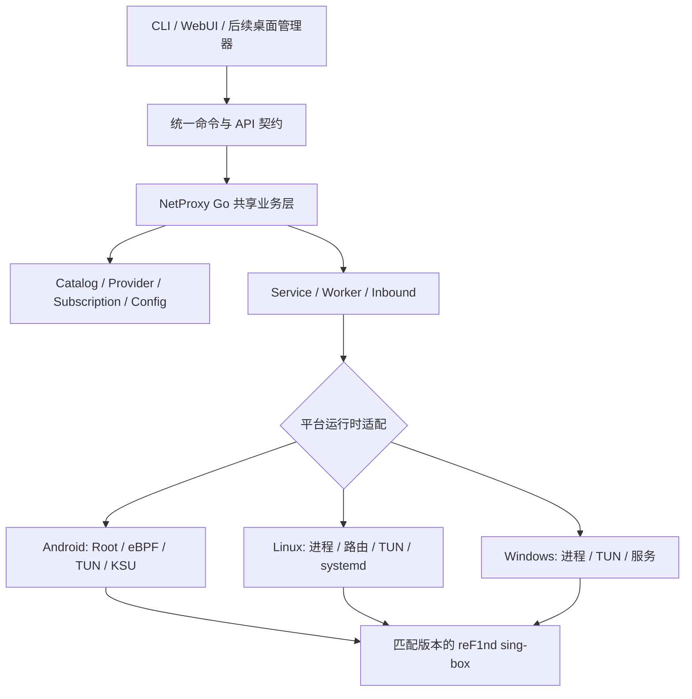

# NetProxy 跨平台移植技术方案

> **文档版本：** v0.1（讨论稿）  
> **编写日期：** 2026-10-10  
> **涉及项目：** [Fanju6/NetProxy-Magisk](https://github.com/Fanju6/NetProxy-Magisk)  
> **目标平台：** Android（保留）、Linux（新增）、Windows（新增）  
> **文档性质：** 可行性分析与技术设计建议；**不是已经完成移植或验证的报告**。

## 1. 执行摘要

NetProxy 当前以 Android Root 环境下的 Magisk / KernelSU / APatch 模块为主要交付形态，但核心管理程序 `netproxyctl` 已采用 Go 实现。节点转换、Provider/Catalog、订阅管理、配置维护、Service API、日志等逻辑具有较强的跨平台复用潜力。

**建议路线：保留一套 Go 业务核心，逐步拆分平台运行时；先完成 Windows/Linux 的 CLI + 本地代理端口（Mixed 入站），再移植 WebUI，最后实现 TUN、系统路由及自动启动。**

需要特别强调：**Go 可以交叉编译，不等于已有程序跨平台功能可直接使用。** 目前已有代码涉及 Android 的安装路径、包名/UID、设备路由、cgroup、启动完成判断，以及 Linux `/proc` 进程管理等平台依赖。Windows 进程管理还存在明显的占位逻辑。

### 1.1 推荐首版范围（MVP）

- Linux amd64、Linux arm64、Windows amd64 独立交付；原 Android 版本行为保持不变。
- 使用与 NetProxy 匹配的 reF1nd sing-box 内核版本。
- 支持节点/订阅的添加、更新、查询与切换；支持规则和运行时配置生成。
- 支持启动/停止/状态/日志，以及本地 `mixed` HTTP/SOCKS 代理监听。
- **暂不要求** TUN 系统全局接管、分应用代理、Wi-Fi 自动策略、eBPF、开机自启或桌面 GUI。
- Windows/Linux 的 WebUI 放在第二阶段；第一阶段先确保 CLI 链路稳定。

### 1.2 完成标准

首版用户在目标系统解压或安装后，可以通过 CLI 导入一个节点或订阅、启动 sing-box、在浏览器或应用中配置 `127.0.0.1` 的 HTTP/SOCKS 代理、切换节点并正常退出；上述操作不依赖 Android 工具、Magisk 或 `/data/adb`。

---

## 2. 当前仓库结构与复用评估

本评估基于 **2026-10-10 查阅的仓库 `main` 分支源文件**，并非完整运行时审计；正式开发前应以具体 commit 固定基线，再运行跨平台构建和测试。

### 2.1 核心目录

```text
src/native/netproxy/
├── cmd/netproxyctl/         # CLI 与内部进程入口
├── internal/
│   ├── catalog/             # Catalog 节点/分组状态
│   ├── config/              # 配置编辑、模式
│   ├── convert/             # 节点转换
│   ├── fetch/               # HTTP 下载
│   ├── inbound/             # eBPF/TUN 受管入站
│   ├── module/              # 配置准备、服务生命周期、Android 模块语义
│   ├── paths/               # 目录布局
│   ├── processlock/         # 跨平台文件锁实现
│   ├── provider/            # Provider 文档
│   ├── service/             # 运行状态、进程查找与控制
│   ├── serviceapi/          # reF1nd sing-box 服务 API
│   ├── subscription/        # 订阅逻辑
│   ├── telemetry/           # 设备统计
│   └── worker/              # 后台更新、网络状态/事件
└── go.mod

src/module/                  # Android 模块布局、配置和 Shell
src/webui/                   # KernelSU WebUI 前端
```

### 2.2 模块复用矩阵

| 组件 | 复用预期 | 新平台需要解决的事项 | 优先级 |
|---|---|---|---|
| `catalog` / `provider` | 高 | 主要做路径及文件系统测试 | P0 |
| `convert` / `fetch` / `subscription` | 高 | 网络、证书、并发、持久化测试 | P0 |
| `config` | 高 | 平台默认配置及兼容规则 | P0 |
| `serviceapi` | 高 | 保证 reF1nd API 与内核版本匹配 | P0 |
| `paths` | 中 | Android 绝对路径与桌面目录映射 | P0 |
| `inbound` | 中 | 添加 Mixed 入站；TUN 校验按平台区分 | P0 / P2 |
| `module` | 中 | 生命周期与 Android 开机/cgroup 行为分离 | P0 |
| `service` | 中 | Windows 进程识别、资源指标、状态恢复 | P0 |
| `worker` | 中 | Linux 网络识别和 Windows 进程/事件适配 | P1 |
| `telemetry` | 高度平台相关 | 首版关闭或按平台明确选择是否启用 | P1 |
| `src/webui` | UI 可复用 | 现有调用方式为 KernelSU `exec`；需新传输层 | P1 |
| `src/module/*.sh` | 低 | 保留 Android 专用，不应直接迁移 | 不移植 |

这里的“复用预期”是从源码职责推断的**改造成本判断**，不是已经量化的代码复用比例。

---

## 3. 已发现的关键平台耦合

### 3.1 路径与目录

涉及：`internal/paths/paths.go`、`src/module/config/singbox/config.json`。

- `paths.go` 默认使用 `/dev/netproxy` 作为运行时状态目录。
- `IsLive()` 明确比较 `/data/adb/modules/netproxy`。
- sing-box 静态配置中，缓存和 Dashboard 仍出现 `/data/adb/modules/netproxy/...` 绝对路径。
- `NETPROXY_MODULE_DIR` 已允许覆盖根目录，是可利用的兼容入口；但**只改根目录变量并不能修复所有绝对路径**。

**建议：** 增加统一 `Layout`/路径策略，区分“便携版目录”与“系统安装目录”；生成平台专属初始配置，并继续兼容 Android 已有安装路径。

### 3.2 Windows 进程生命周期未完成

涉及：`internal/module/service_process_windows.go`、`internal/worker/process_windows.go`、`internal/service/control.go`。

查阅到的 Windows 实现包括：

```go
func serviceProcessAlive(_ int) bool { return false }
```

并且 `worker` 的 Windows 进程检查、终止等行为包含占位实现；`service.FindProcess()` 则使用 Linux `/proc` 枚举或匹配可执行文件。

**影响：** Windows 上“启动成功后确认就绪、停止、重启、状态查询、后台 Worker”等流程无法仅靠改 `GOOS` 保证正确。

**建议：** 使用进程句柄 + OS API 或进程管理抽象实现进程识别；验证 PID 对应的可执行文件身份，避免 PID 重用或误杀；为关闭、超时及失败恢复提供明确路径。

### 3.3 Android 系统专属操作

- `internal/inbound/applications.go` 调用 `cmd package list packages ... -U`，属于 Android 包名/UID 查询。
- `internal/module/lifecycle.go` 的 `Boot()` 调用 `resetprop -w sys.boot_completed 0` 等待 Android 启动完成。
- `internal/module/cgroup.go` 操作 `/sys/fs/cgroup/cgroup.procs` 以调整 sing-box 所处的 cgroup。
- `internal/worker/network_route_unix.go` 虽带 `linux || android` build tag，但默认路由判断按 Android policy routing 方式实现，并不代表适用所有通用 Linux 发行版。
- `internal/worker/network_wifi_other.go` 等平台文件对 Windows 明确返回未支持。

**建议：** Android 特性继续留在 Android 适配层；Linux/Windows 首版不实现包名分流、Root 特殊策略、Android Wi-Fi 策略。可用特性必须显式标记支持状态，不应静默假成功。

### 3.4 入站与配置校验的单平台假设

涉及：`internal/inbound/config.go`、`internal/inbound/tun.go`、`internal/inbound/runtime.go`、`internal/module/state.go`。

- 当前受管入站限定 `ebpf` / `tun` 两类。
- 当前 TUN 校验同时强制 `auto_route`、`auto_redirect`。
- 入站生成与应用策略可能解析 Android UID；运行状态中的 `ActiveBackend` 合法值也限定为 `ebpf` / `tun`。
- 某些路由标记冲突判断以当前 `auto_redirect` 使用方式为前提。

**建议：** 在配置、运行时构建、状态持久化、CLI/WebUI 类型定义与测试中**统一引入**新后端，不要只修改一个验证条件；将平台能力矩阵作为明确校验依据。

### 3.5 WebUI 依赖 KernelSU

涉及：`src/webui/src/exec.ts`。

现有 WebUI 通过 `kernelsu` 包的 `exec()` 执行命令，并固定使用：

```ts
const CTL = '/data/adb/modules/netproxy/netproxyctl'
```

**建议：** 抽象 `CtlTransport`：Android 使用 `KernelSUExecTransport`；Windows/Linux 使用 `LocalHTTPTransport`。继续复用已有的 `schema=1` JSON 命令契约及 UI，避免维护两套前端。

---

## 4. 目标架构



### 4.1 设计原则

1. **一个业务核心，多个平台适配器：** 不复制节点、订阅和配置业务逻辑。
2. **Android 行为零回退：** Android 原构建、命令输出和已有数据布局优先保持兼容。
3. **能力驱动而不是平台判断散落全项目：** 例如 `SupportsTUN`、`SupportsAppFilter`、`SupportsAutoRedirect`，必要时结合 build tags。
4. **不把 Magisk 安装布局作为 Go 业务的默认世界观：** `module` 中的通用逻辑逐步提取到 `runtime/service`，避免一次性大重构。
5. **配置变更可回滚、进程退出可恢复：** 启停和网络路由修改应有失败恢复策略。
6. **保留 CLI JSON 契约：** 当前 `netproxyctl` 的 `schema=1` 是多入口集成的基础；扩展字段时兼容旧版客户端。

### 4.2 建议目录布局（目标形态，不要求一步到位）

```text
src/native/netproxy/
├── cmd/netproxyctl/
├── internal/
│   ├── platform/
│   │   ├── android/
│   │   ├── linux/
│   │   └── windows/
│   ├── runtime/               # 可逐步承接原 module 公共生命周期
│   ├── catalog/
│   ├── subscription/
│   ├── inbound/
│   ├── service/
│   └── ...
```

**避免过度设计：** 初期也可以仅在现有目录中新增 `*_windows.go`、`*_linux.go`、`*_android.go` 并用 build tags 分离；只有平台分歧显著增长时再抽到独立目录。

---

## 5. 入站方案：先 Mixed，再 TUN

### 5.1 第一阶段（MVP）：Mixed 本地代理

建议在受管入站配置中增加第三种后端（命名暂定 `proxy`）：

```json
{
  "backend": "proxy"
}
```

生成对应的 sing-box `mixed` 入站，默认仅绑定 `127.0.0.1`，通过 HTTP/SOCKS 代理端口工作。下列仅为**生成后的 sing-box 入站示例**，并非可直接替换现有完整 `inbound.json` 的正式格式：

```json
{
  "type": "mixed",
  "tag": "netproxy-in",
  "listen": "127.0.0.1",
  "listen_port": 2080
}
```

这能让 Linux/Windows 首版立即使用节点与订阅功能，而无须首先解决 TUN 驱动、系统 DNS、路由冲突等高风险事项。

### 5.2 第二阶段以后：TUN

| 项目 | Linux | Windows |
|---|---|---|
| 虚拟网卡 | Linux TUN | 由 sing-box 所使用的 Windows TUN 实现/驱动提供 |
| 路由接管 | `auto_route`，按内核及规则环境验证 | `auto_route`，兼顾多个网卡/VPN |
| `auto_redirect` | 在兼容环境内按 sing-box 支持情况启用 | **不照搬 Linux 的 `auto_redirect` 配置** |
| DNS | 检查 resolved/NetworkManager 等环境 | 检查系统 DNS、接口切换与回滚 |
| 提权 | root 或所需 capability | 管理员权限及相应驱动条件 |
| 退出恢复 | 清除临时路由/规则 | 恢复路由和 DNS，防止断网 |

**注意：** 实际支持能力要以 NetProxy 所用 reF1nd sing-box 版本在各平台的构建和运行测试为准；不能仅从上游文档推断 fork 的每个功能都存在。

### 5.3 分应用代理

首版不启用此功能。后续：

- Android：保留包名 / Android 用户 ID / UID 机制。
- Linux：可以研究 UID/cgroup/网络命名空间等不同机制，需明确支持的发行版和启动方式。
- Windows：进程级过滤可能依赖 Windows 网络过滤机制或与核心兼容的现有实现；不能把 Android 包名策略直接移植。

---

## 6. 进程、目录与后台服务适配

### 6.1 平台目录建议

| 场景 | 建议路径 |
|---|---|
| Android 模块 | 继续使用 `/data/adb/modules/netproxy` |
| Linux 便携版 | 程序相对目录或用户显式指定根目录 |
| Linux 正式安装 | 配置 `/etc/netproxy`；状态 `/var/lib/netproxy`；日志按发行方式决定 |
| Windows 便携版 | 可执行文件旁相对目录或可写数据目录 |
| Windows 正式安装 | 用户数据 `%LOCALAPPDATA%`；系统服务数据 `%PROGRAMDATA%` |

保留环境变量覆盖，统一维护所有绝对路径；**避免将需要管理员权限的程序目录当作用户可写配置目录。**

### 6.2 服务管理

- 共享层：`Start / Stop / Restart / Status / Check / Reload` 的业务语义、状态数据、锁、超时与日志。
- Android：启动完成检测、Root cgroup 调整及模块脚本。
- Linux：进程信号/生命周期，后续使用 systemd 管理；无需强制覆盖 cgroup 根组。
- Windows：进程句柄、退出检测、服务控制；不假设 `os.Interrupt` 等价于 Unix 信号机制。

**特别要求：** `signalServiceReload` 在 Windows 上不能未经验证就靠给 PID 发送 `os.Interrupt` 达到热重载。优先通过已经可用且匹配版本的 Service API 进行受控操作；不能支持时应明确返回 `restart_required` 或采用安全重启，而不是宣称无中断重载。

### 6.3 Worker

建议从“先启动代理”出发，逐项恢复：

1. Windows/Linux 上订阅定时更新；
2. 后台任务退出、重新拉起和进程身份识别；
3. 网络变化事件；
4. Wi-Fi 自动切换策略（非 MVP）。

首版可以明确关闭部分 Worker 特性，以免“代理服务可用但自动任务失败”引起误判。

---

## 7. WebUI 跨平台方案（第二阶段）

采用“现有前端 + 新控制传输层”，不立即开发新的 Electron/Tauri 桌面端。

```text
Android: WebUI -> KernelSU exec -> netproxyctl
Linux/Windows: Browser -> localhost HTTP API -> netproxyctl 业务逻辑
```

建议：

- 前端增加 `CtlTransport` 接口和 `KernelSUExecTransport` / `LocalHTTPTransport` 实现。
- Go 侧托管静态 WebUI 资源，并提供**受控**的节点、订阅、服务、配置、日志 API。
- 不提供可执行任意 shell 命令的公共 HTTP 端点；必要操作通过显式允许的命令映射实现。
- 默认仅监听 `127.0.0.1`；启用身份认证、CSRF/Origin 校验、请求参数验证和适当的权限控制。
- 禁止把 `Service API` 密钥或敏感订阅凭据直接暴露到前端日志和公开响应。

**附带收益：** 后续 Windows 桌面管理器可以复用该本地服务接口。

---

## 8. 构建与发布

### 8.1 先做交叉编译探测

在 `src/native/netproxy` 下运行：

```bash
CGO_ENABLED=0 GOOS=linux GOARCH=amd64 \
  go build -pgo=off -o netproxyctl-linux-amd64 ./cmd/netproxyctl

CGO_ENABLED=0 GOOS=linux GOARCH=arm64 \
  go build -pgo=off -o netproxyctl-linux-arm64 ./cmd/netproxyctl

CGO_ENABLED=0 GOOS=windows GOARCH=amd64 \
  go build -pgo=off -o netproxyctl-windows-amd64.exe ./cmd/netproxyctl
```

`-pgo=off` 仅用于初期探测；现有默认 PGO profile 来自 Android 设备，应在桌面端有独立性能数据后再决定是否训练专属 PGO。

> **当前状态：尚未执行上述目标平台的完整构建及运行测试。** 编译成功不等于网络接管、服务管理或 CLI 子命令正确。

### 8.2 发布包建议

```text
netproxy-linux-amd64.tar.gz
netproxy-linux-arm64.tar.gz
netproxy-windows-amd64.zip
```

每个包包括目标平台 `netproxyctl`、与 Service API 配套的 `sing-box`、平台默认配置与必要的 WebUI 文件（第二阶段）。

### 8.3 CI 工作项

- GitHub Actions 构建矩阵：`linux/amd64`、`linux/arm64`、`windows/amd64`；Android 构建流程保留。
- Linux Runner 运行 Linux CLI 单元测试；Windows Runner 运行 Windows CLI 单元测试。
- 使用固定版本的 Go / reF1nd sing-box，确保产物版本和兼容 API 一致。
- 验证配置生成、节点导入、启动/停止/重启、失败回滚、日志脱敏、路径空格/中文字符。
- 在可控 VM 中执行 TUN 的特权网络测试，不在普通 CI Runner 上冒险修改默认路由。

---

## 9. 分阶段交付与验收

| 阶段 | 目标 | 关键交付物 | 验收条件 |
|---|---|---|---|
| **P0：可运行 CLI** | Linux/Windows 本地代理 | 路径适配、Mixed 入站、进程管理、对应 sing-box 包 | 三平台能导入节点并通过本地端口访问网络；启动/停止可靠 |
| **P1：WebUI + Worker** | 具有可用管理界面 | 浏览器本地 API、WebUI 传输层、订阅调度 | 可以管理节点/订阅、查看状态和日志；权限受控 |
| **P2：TUN** | 系统级代理能力 | TUN 配置、路由/DNS、安全退出恢复 | 测试机在启动、断网、异常退出后网络可恢复 |
| **P3：平台增强** | 接近长期正式产品 | Linux systemd、Windows 服务/托盘、平台级规则 | 安装/升级/自启动和稳定性达到正式发布标准 |

### 9.1 回归测试重点

1. **Android 零回退**：Magisk/KernelSU/APatch 的原有安装与启动流程、eBPF、TUN、节点切换保持不变。
2. **CLI 契约**：JSON `schema=1` 的成功/失败结构及退出码保持一致；新增功能不破坏既有消费者。
3. **文件与状态**：中途崩溃后能重新进入服务；锁、PID、运行时配置可正确清理。
4. **网络与隐私**：本地代理默认不对局域网开放；日志、错误响应不泄露订阅鉴权信息。
5. **路由安全**：TUN 开启时避免流量回环；强杀核心后有明确路由/DNS 恢复策略。
6. **平台差异**：Windows 路径、文件锁、进程权限；Linux 不同发行版和 systemd/non-systemd 环境。

### 9.2 风险与应对

| 风险 | 影响 | 缓解 |
|---|---|---|
| reF1nd fork 的目标平台行为与上游不一致 | 构建失败或 Service API 不兼容 | 固定 commit；先构建内核再做集成测试 |
| Windows 进程管理仍沿用占位逻辑 | 状态错误、停止失败 | P0 优先完成进程管理与真实 Windows 测试 |
| 只加 `backend=proxy` 却遗漏状态/CLI/UI | 配置能保存但运行失败 | 统一检查配置、生成器、状态、契约和测试 |
| Android 配置绝对路径残留 | Windows/Linux 无法启动 | 引入配置模板及绝对路径扫描测试 |
| TUN 修改默认路由或 DNS 后异常退出 | 系统断网 | P2 单独实施，先做路由回滚及 VM 测试 |
| 任意命令执行接口通过 WebUI 暴露 | 本地提权/远程风险 | 严格命令映射、鉴权、仅监听本地 |
| 一次性大重构影响 Android 稳定版本 | 原有用户回退 | 分阶段、小 PR、Android 回归测试作为合并门禁 |

---

## 10. 建议的首批开发任务（按顺序）

- [ ] 固定移植基线 commit，记录当前 Android CLI 行为及核心版本。
- [ ] 建立 Windows/Linux 构建探测与最小 CI 矩阵，列出真实编译错误。
- [ ] 抽离运行时路径默认值，处理配置中的 `/data/adb` 绝对路径。
- [ ] 增加 `proxy`/Mixed 受管入站，并覆盖配置校验、生成、状态和 CLI 输出。
- [ ] 修改 Linux 进程/cgroup 调用边界，避免通用 Linux 继承 Android 的特定行为。
- [ ] 实现 Windows 进程检测/停止/存活判断，修复 Worker 占位逻辑。
- [ ] 修复目标平台 `service status/check/start/stop/restart` 链路。
- [ ] 构建并打包与 NetProxy 版本匹配的 reF1nd sing-box。
- [ ] 使用实际 Linux VM 和 Windows VM 验证本地 Mixed 入站与节点订阅。
- [ ] Android 全链路回归通过后，发布首个跨平台预览版。

---

## 11. 待决策事项

以下问题目前**建议暂不锁死**，可在 P0 实测后确定：

| 决策 | 当前建议 | 备选方案 |
|---|---|---|
| 是否继续同一仓库 | **是**，一个核心、多个发行包 | 未来复杂度较高再拆仓库 |
| Linux/Windows 首版是否必须透明代理 | **否**，先 Mixed 端口 | 直接实施 TUN（增加风险和工期） |
| Windows 首版是否需要 GUI | **否**，先 CLI + 后续 WebUI | 直接 Tauri/Electron |
| Windows/Linux WebUI 控制方式 | 本地受控 HTTP API | IPC/Named Pipe/Unix Socket + 桥接层 |
| 是否支持非 Root Linux TUN | P2 再确定权限模型 | 首版仅提供端口代理 |
| Linux 发行版支持边界 | 首批 Debian/Ubuntu，明确测试基线 | 同时覆盖多发行版 |
| 旧配置迁移 | Android 保持不动；桌面生成独立默认配置 | 尝试直接搬迁 Android 配置（风险较高） |

## 12. 最终建议

**建议批准一个边界清晰的 P0 试点，而不是立即投入完整“跨平台透明代理客户端”建设。**

P0 的价值在于验证两件关键事实：第一，现有 Go 业务层能否低成本独立于 Android 运行；第二，NetProxy 依赖的 reF1nd sing-box 能否在目标平台可靠工作。只有这两点得到实际测试证明，继续投入 WebUI、TUN 与系统服务才具备明确依据。

如果 P0 验证成功，NetProxy 可由“Android Magisk 透明代理模块”逐步发展为“共享 Go 核心、覆盖 Android/Linux/Windows 的代理管理平台”，并保留 Android 版本已经形成的技术优势。

---

## 13. 关键源码索引

- [Go 核心说明](https://github.com/Fanju6/NetProxy-Magisk/blob/main/src/native/netproxy/README.md)
- [Go 模块依赖与 reF1nd sing-box 版本](https://github.com/Fanju6/NetProxy-Magisk/blob/main/src/native/netproxy/go.mod)
- [CLI 主入口](https://github.com/Fanju6/NetProxy-Magisk/blob/main/src/native/netproxy/cmd/netproxyctl/main.go)
- [目录布局 `paths.go`](https://github.com/Fanju6/NetProxy-Magisk/blob/main/src/native/netproxy/internal/paths/paths.go)
- [服务生命周期 `lifecycle.go`](https://github.com/Fanju6/NetProxy-Magisk/blob/main/src/native/netproxy/internal/module/lifecycle.go)
- [Windows 进程实现](https://github.com/Fanju6/NetProxy-Magisk/blob/main/src/native/netproxy/internal/module/service_process_windows.go)
- [服务控制与 Linux `/proc` 逻辑](https://github.com/Fanju6/NetProxy-Magisk/blob/main/src/native/netproxy/internal/service/control.go)
- [受管入站校验 `tun.go`](https://github.com/Fanju6/NetProxy-Magisk/blob/main/src/native/netproxy/internal/inbound/tun.go)
- [当前入站默认配置](https://github.com/Fanju6/NetProxy-Magisk/blob/main/src/module/config/inbound/inbound.json)
- [KernelSU WebUI 命令调用](https://github.com/Fanju6/NetProxy-Magisk/blob/main/src/webui/src/exec.ts)
- [现有构建流程](https://github.com/Fanju6/NetProxy-Magisk/blob/main/.github/actions/build-module/action.yml)

> **备注：** 本稿是基于源码静态检查编制的设计草案，未运行跨平台编译、集成测试、性能基准或完整安全审计。新增配置字段及 API 结构需在实现阶段进一步定稿。