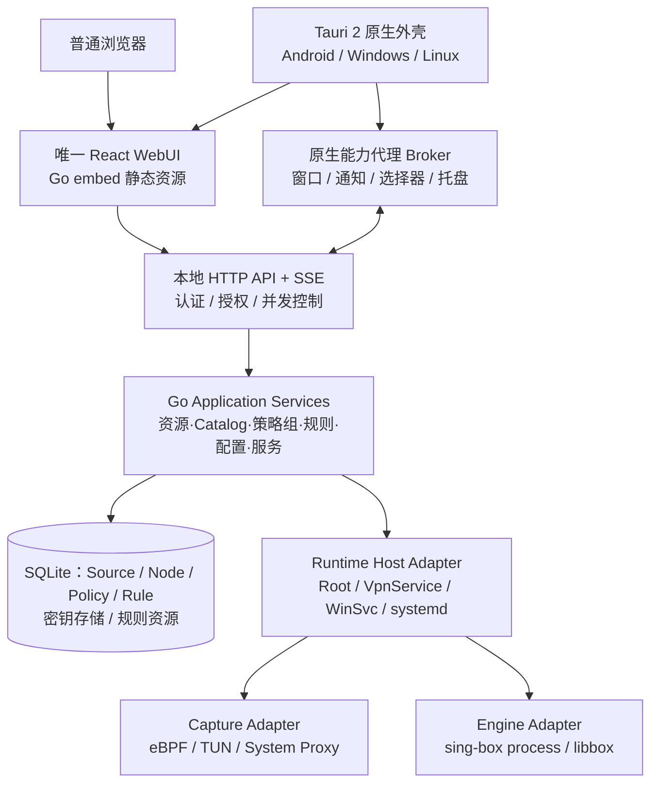
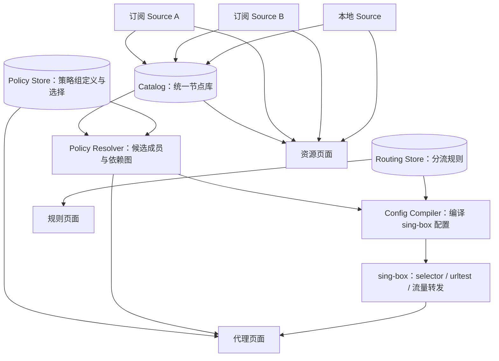
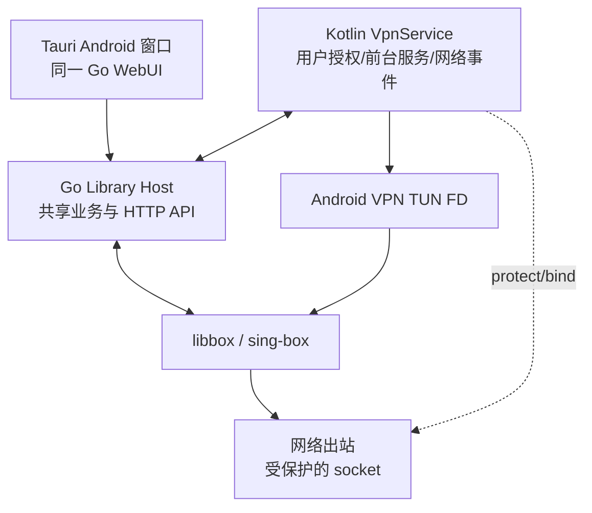

# NetProxy 9.0 — 全新架构设计与实施规范

> **文档版本：** 1.1（策略组、资源管理与页面体系纳入架构基线 / 待 P0 验证）  
> **制定日期：** 2026-10-10  
> **项目：** NetProxy 9.0  
> **目标平台：** Android / Windows / Linux  
> **技术路线：** Go Core · Go 内置 WebUI · React · Tauri 2 · sing-box  
> **定位：** 全新产品架构设计，不是 NetProxy 8.x 的移植或兼容升级指南。

---

## 0. 执行摘要与架构决议

**NetProxy 9.0 是一次允许破坏性变更的全新架构重构。** 不继承旧版内部 API、CLI、文件目录、数据格式、进程模型、应用界面或历史数据迁移要求。8.x 只作为功能体验与问题案例的参考，不是设计约束。既有代码可用则用，不优则弃，不以代码复用率评估重构成功。

本方案确立：

1. **Core-first：** Go Core 是唯一通用业务事实源，承载配置、Catalog、订阅、策略组、规则、运行编排、管理 API、可观测性等能力。
2. **Embedded WebUI：** 唯一完整 React WebUI 打包到 Go Core，独立浏览器和 Tauri 使用同一份服务端 UI；不维护第二套业务页面。
3. **Thin Native Shell：** Tauri 2 负责 Android、Windows、Linux 的应用外壳、系统窗口与受限原生能力，**不是代理存活的前提**。
4. **平台最适化：** Android Root、Android 无 Root VPN、Windows、Linux 可以采用不同的数据面、权限和进程部署模型，禁止为“形式统一”牺牲系统正确性。
5. **安全默认闭合：** 本地管理 API 即使监听 loopback 也需鉴权；Web 页面不直接获得任意 Root、Shell、系统文件权限。
6. **明确不兼容：** 不提供 8.x 配置解析器、自动迁移、升级兼容层或双格式维护。9.0 从全新数据空间初始化；不对历史安装作无损升级承诺。
7. **策略组是一等资源：**「代理」展示与管理策略组；「资源」管理订阅、手动节点和 Catalog；「规则」将流量映射到策略组。节点来源不再决定主出口，策略组定义、解析成员和引擎运行状态分别有独立事实源。
8. **务实的模块化单体：** 按真实职责划分边界，不引入微服务、动态插件市场、抽象工厂层层套用等无收益设计。

### 0.1 产品形式

| 产品载体 | 组成 | 核心使用方式 |
|---|---|---|
| Android Root Edition | Root 模块：Go 守护服务 + sing-box；Tauri APK 可选 | eBPF / Root TUN；浏览器或 APK 管理 |
| Android VPN Edition | Tauri APK + Kotlin `VpnService` + Go 原生库 + sing-box/libbox | 无 Root VPN；APK 安装和系统 VPN 授权必需 |
| Windows Edition | 独立 Go 后台服务 + sing-box；Tauri 客户端可选 | TUN / 系统代理 / Mixed，视权限和驱动实现 |
| Linux Edition | 独立 Go Daemon + sing-box；Tauri 客户端可选 | TUN / 系统代理 / Mixed；支持无桌面环境 |
| Browser WebUI | Go Core 内置的 React 页面与同源 HTTP API | 完整通用管理能力，无本机原生增强能力 |

> **重要边界：** 无客户端 ≠ 无核心。浏览器必须连接已经运行的 Go 服务；Android **无 Root VPN** 的 Go 服务由 APK 中的 Android Service 承载，不存在完全不安装 APK 就使用系统 VpnService 的方案。

---

## 1. 非目标：明确不做什么

- 不为 NetProxy 8.x 保留任何字段、API、CLI、配置路径、缓存结构、状态码的历史兼容性。
- 不提供旧配置自动迁移、旧数据库升级适配、旧 APK 包名/签名升级连续性保证。
- 不为兼容旧 Compose 管理器而设计 9.0 通信协议；全新业务 UI 以 React 重建。
- 不把 Tauri 客户端视作管理后台的唯一宿主，也不让关闭窗口停止网络代理。
- 不为了“Go 单进程”把所有平台强制改成进程内 sing-box；进程内/进程外以系统场景择优。
- 不在首次发布就承诺跨设备远程控制、云账户同步、每个平台一致的高级分应用流量识别、所有发行渠道或所有 CPU 架构。
- 不在 9.0 初期引入可替换任意代理引擎的公开插件 ABI；只建立最小的 sing-box 适配边界。
- 不建立任意命令远程执行接口；管理 API 只暴露经过定义和校验的业务操作。

## 2. 总体架构



### 2.1 五条不可跨越的职责线

| 层 | 应拥有的内容 | 绝不能拥有的内容 |
|---|---|---|
| UI（React） | 页面、交互状态、可视化、输入校验、能力降级呈现 | 订阅事实源、真实服务状态、系统命令拼接 |
| Transport（Go） | HTTP/CLI 接入、认证、授权、参数校验、事件推送 | 领域决策和重复业务流程 |
| Application / Domain（Go） | 业务用例、状态机、策略、配置生成与事务 | Android/Win32 专用代码、窗口/UI 控制 |
| Runtime / Engine / Capture（Go + 平台代码） | 进程、网络接管、TUN、socket 保护、核心状态 | Catalog 数据模型、订阅解析规则的副本 |
| Native Shell（Tauri + Kotlin/Rust） | OS 交互、权限引导、通知、托盘、文件选择 | 第二套业务数据库、第二套节点/订阅实现 |

原则：**一个业务操作只有一个 Application Service 入口**，不允许 HTTP、CLI、Tauri 各自另写业务实现。

---

## 3. Go Core 的全新内部设计

### 3.1 采用模块化单体

建议使用“领域 + 用例 + 基础设施”三层，而非按 HTTP/Android 入口组织全部业务文件。

| 业务域 | 关键职责 | 单一事实源 |
|---|---|---|
| Profile | 管理独立配置档案、当前档案与环境策略 | Core DB |
| Resource / Catalog | 统一节点实体、来源归属、手动节点、查询与元数据；不负责决定当前代理出口 | Core DB（Source / Node） |
| Subscription | 获取、转换、更新、有效性检验与来源快照提交 | Core DB（Subscription / Source） |
| Policy | 策略组定义、成员选择器、嵌套引用、组内选择与图校验 | Core DB（PolicyGroup / PolicySelection） |
| Routing | 流量条件、规则集、策略组目标、DNS 与平台适用性 | Core DB（RoutingRule）+ 配置模型 |
| Runtime | 服务状态机、运行计划、启动/停止/重载、故障恢复 | 运行时状态机 + OS/引擎观测 |
| Telemetry（可选） | 本地运行统计、诊断导出 | 隔离存储；默认不上传外部服务 |

不把 `EngineAdapter`、`CaptureAdapter` 做成过度通用的复杂插件系统；只有第二种真实实现需要差异时才扩展接口。

### 3.2 控制面与数据面分离

- **控制面（Control Plane）：** 管理配置、节点、订阅、策略、服务状态、HTTP API、CLI 与 WebUI。
- **数据面（Data Plane）：** TUN/eBPF/系统代理捕获流量，交给 sing-box 解析规则、处理 DNS 与出站连接。
- **状态机（Runtime Coordinator）：** 负责把“期望状态”收敛为“可验证的实际运行状态”。

Go Core 不自己重新实现通用 TCP/IP 代理栈；优先复用 sing-box 的成熟流量处理能力。

### 3.3 Runtime Host、Capture、Engine 是三个维度

不再出现“`backend=ebpf/tun/vpn` 决定整个系统行为”的单一大枚举。

```text
Runtime Host（谁负责存活与权限）
  ├── android-root
  ├── android-vpn
  ├── windows-service
  └── linux-daemon

Capture（流量怎样进入代理引擎）
  ├── ebpf
  ├── tun
  ├── android-vpn-tun
  ├── system-proxy
  └── mixed-listener

Engine（流量由谁解析与转发）
  ├── sing-box-process
  └── sing-box-libbox
```

**允许组合必须由平台能力注册表验证**，而不是将任意 Host × Capture × Engine 组合全部视作合法。

例如：`android-vpn + ebpf` 不合法；`android-vpn + android-vpn-tun + libbox` 合法；Windows 默认不能借用 Android 的包名/UID 规则。

### 3.4 核心状态机与错误语义

```text
stopped → preparing → starting → ready
    ↑          │          │       │
    └──────────┴─ failed ←────────┘
                              │
                         stopping → stopped
```

- `desired_state` 表示用户意图；`observed_state` 表示当前真实状态；两者不能混用。
- 只有实际引擎就绪、预期接管方式验证成功，才能进入 `ready`。
- 服务启动失败不静默切换成另一个 Capture，也不悄悄改写用户配置。
- 每次实例使用运行 ID / generation，防止旧事件覆盖新实例的状态。
- 所有修改操作提供操作 ID；重复请求可幂等，取消与超时语义明确。
- 失败时优先保留最后一次有效配置快照，不能写坏当前可运行配置。
- 启动/停止/重载/配置提交在单运行实例内串行；状态快照读取不阻塞长事务。

### 3.5 核心配置模型与引擎配置的关系

**用户配置 ≠ sing-box 运行配置。**

建议用户配置包含：`profiles`、`sources`、`catalog`、`subscriptions`、`policy_groups`、`routing`、`dns`、`capture_preference`、`platform_overrides`、`ui_preferences`。Core 从 Source 构建 Catalog 节点库，以 Policy Resolver 解析策略图，再结合路由与平台能力编译为 sing-box 的实际配置，并保留生成结果的只读诊断视图。**不可把节点来源、策略组选项与实际运行出口合并为同一个“当前选择”字段。**

对于高级用户保留 JSON + Schema 编辑，但不允许两套配置来源相互覆盖：

- **Managed Mode：** NetProxy 的 Catalog、PolicyGroup、RoutingRule 等领域模型为事实源，Core 编译生成 sing-box 配置；WebUI 可视化编辑策略组与规则。
- **Expert Mode：** 用户明确选择原生 sing-box 配置为事实源；Core 只做合法性检查、平台注入和运行编排；「代理」可读取引擎实际策略组并展示只读运行投影，但不把它们偷偷导入 Managed 策略组库，也不由 Managed 表单写回原生字段。
- 两模式采用**显式切换与清晰警告**；不做隐式双向同步、不做模糊 JSON 合并。
- Catalog 等通用节点存储可以作为独立资源提供给两种模式，但其引用规则必须显式声明并可验证。

这样既能提供方便的表单，也能保留 sing-box 原生能力，不制造两个互相矛盾的配置事实源。

---

## 4. 全新持久化设计

### 4.1 默认选择

- **SQLite：** 结构化元数据、Profile、Source、Catalog Node、Subscription、PolicyGroup、PolicySelection、RoutingRule、设置、操作记录、事务版本。
- **文件系统：** 较大的规则资源、显式导入的原始文件、诊断包、运行时编译快照。
- **系统密钥存储 / 受限文件：** API 凭据、会话密钥、可能包含敏感内容的密钥材料；Android VPN App 可使用 Android Keystore 等系统能力，Root/桌面环境按实际权限隔离设计。
- **单写入所有权：** 当前活动实例由一个 Core 写入；Android Root 和 VPN 运行载体各有独立数据空间，禁止同时修改同一个 SQLite 文件。

### 4.2 持久化保证

1. 新配置先校验后原子提交，不能出现“数据库已改，运行文件只写了一半”。
2. 运行时资源使用 staging → 校验 → 原子发布；异常终止后可清理或恢复到最近有效快照。
3. 数据库事务与外部引擎操作无法做到单个 ACID 事务，应使用明确的事务阶段记录和可重试协调，而非假装原子。
4. 敏感信息不出现在默认日志、URL 查询参数、遥测事件和诊断包中。
5. 用户显式导出/备份是当前产品功能，不代表承诺导入 8.x 数据；**不提供旧版自动迁移**。

### 4.3 版本与兼容策略

- 9.0 内部契约重新定义，不继承 `schema=1` 的历史兼容要求。
- Go 内置 UI 与当前 Go API **同包构建**，避免前后端版本漂移。
- Tauri 连接 Core 时必须完成协议能力握手；不兼容就拒绝高风险操作并提示更新，不增加兼容逻辑。
- 在新版实现中使用版本号用于检测和拒绝不匹配，**并不等同于支持历史版本兼容**。

---

## 5. 管理 API 与实时状态

### 5.1 技术决策

- 默认 **本机 HTTP/JSON API**；WebUI 与 API 同源。
- **SSE** 用于状态、流量、日志等服务器单向推送；只有明确需要双向高速消息流才引入 WebSocket。
- **CLI** 复用相同 Application Services；如需跨权限控制，可通过本地认证 IPC 代理，而不是直接复制业务处理逻辑。
- 本地服务优先 loopback 监听；未来若开放 LAN/远程访问，必须独立设计 TLS、配对及授权，不作为 9.0 首发默认功能。

示例接口（**全新协议草案，非已实现 API**）：

```http
GET    /api/system/manifest
GET    /api/runtime/status
POST   /api/runtime/start
POST   /api/runtime/stop
POST   /api/runtime/reload
GET    /api/profiles
POST   /api/profiles
GET    /api/resources/sources
GET    /api/catalog/nodes
GET    /api/policies
GET    /api/policies/{id}
POST   /api/policies
POST   /api/policies/{id}/resolve     # 预览动态成员
POST   /api/policies/{id}/select      # 选择候选成员
GET    /api/routing/rules
POST   /api/subscriptions/refresh
GET    /api/config/compiled
POST   /api/config/validate
GET    /api/events                 # SSE
GET    /api/platform/capabilities
```

建议返回结构：

```json
{
  "ok": true,
  "data": { "state": "ready", "generation": "example-id" },
  "error": null,
  "request_id": "example-request-id"
}
```

错误 `code` 稳定、`message` 面向用户、`details` 面向诊断；敏感详细错误不能直接原样暴露给网页。

### 5.2 API 身份与授权

**Loopback 不是安全边界。** Android 本地其他 App、桌面本机其他进程，以及恶意网页都可能尝试请求本地监听端口。

最低要求：

- 未验证身份的客户端不得修改状态或读取包含凭据的配置。
- WebUI 通过专用登录/解锁流程建立短生命周期会话；优先 `HttpOnly` 会话 Cookie + CSRF 防护；HTTPS 部署使用 `Secure` 属性。
- 校验 `Host` 和 `Origin`，限制跨域请求，阻止 DNS rebinding 和不可信站点跨站调用。
- 禁止将高权限长期令牌放在 URL、localStorage 或静态 Web 资源中。
- 本地首次信任建立使用操作系统可信通道（例如 CLI 一次性配对码、私有 IPC、服务安装时配置的凭据）。
- 敏感操作需要操作级授权；锁定浏览器来源、Tauri 来源、CLI 来源各自的能力范围。
- 仅在显式设置后允许远程访问；此时应改用 HTTPS 与设备级凭证，并重新进行安全审计。

---

## 6. Go 内置 WebUI

### 6.1 确定技术栈

| 部分 | 选择 | 原因 |
|---|---|---|
| UI 框架 | React + TypeScript | 业务组件共享、类型约束明确 |
| 构建 | Vite | 静态产物易内置 |
| 组件 | shadcn/ui + Tailwind CSS | 可控源码与跨端响应式设计 |
| 服务端数据 | TanStack Query | 缓存、失效、错误与重试策略 |
| 轻量 UI 状态 | Zustand | 不把服务端事实源复制到前端 |
| 表单 / 校验 | React Hook Form + Zod | 交互体验与输入校验 |
| 编辑器 | Monaco 或 CodeMirror 6（按移动端性能验证选型） | JSON + Schema、语法提示 |
| 图表 | ECharts / uPlot（二选一，基准测试决策） | 实时流量可视化 |

前端不要以框架数量作为“现代化”的指标；仅引入被真实功能使用的依赖。

### 6.2 Go embed

流水线：

```text
React 源码 → Vite 构建 dist/ → Go //go:embed → Core 二进制/原生库
                                                    ↓
                                         HTTP 静态资源 + API
```

- `/` 返回单页应用；`/assets/*` 使用哈希文件名与长期缓存；`index.html` 短缓存。
- 资产内置在服务端，Tauri 不复制业务 React 页面。
- 资源离线可用：不把 CDN 字体、图标、JS 作为必需依赖。
- Android VPN 版的 Go 原生库中可以包含 WebUI 静态资源，由 VPN Service 的生命周期内本地 HTTP 服务提供；是否独立保持 HTTP 服务由原生 Service 状态机决定。

### 6.3 浏览器与 Tauri 表现

**浏览器与 Tauri 获得完全相同的通用业务功能。** 差别仅在平台原生增强：

| 功能 | Browser | Tauri |
|---|---|---|
| 代理策略组、资源/Catalog、订阅、规则、配置、服务操作 | Go API 完整支持 | 相同 Go API |
| 日志、流量、连接可视化 | 支持 | 支持 |
| Go 能查询到的应用列表 | 支持 | 支持，可增强图标与选择器 |
| 系统托盘 / 全局快捷键 | 不提供 | 平台支持时提供 |
| Android VPN 授权 | 浏览器可提示用户切换 App | Kotlin 原生授权流程 |
| Android 快捷设置磁贴 | 不提供 | Kotlin Android 组件 |
| 文件导入/导出 | 浏览器选择/下载 | 可使用原生文件对话框与分享 |
| 通知 | 浏览器权限限制 | 系统原生通知 |

**能力声明而非页面分叉：** Go Core 返回 `core_capabilities`，Tauri Broker 返回 `native_capabilities`。React 根据能力决定按钮/交互；不能把缺失原生能力当作业务核心不可用。

---

## 7. 「代理 / 资源 / 规则」产品体系与策略组数据架构

本章是 9.0 正式产品架构的一部分，而非 UI 附录。**NetProxy 9.0 不再将 Catalog 中的订阅分组当作代理选择器，也不再使用「当前来源 + 当前节点」决定系统的唯一主出口。**

### 7.1 信息架构与导航

| 一级页面 | 主要对象 | 面向用户的职责 | 对应事实源 |
|---|---|---|---|
| **概览** | Runtime / Traffic / 当前活动 Profile | 查看当前服务、流量、活动模式、常用策略组与异常 | Runtime Coordinator + Engine Snapshot |
| **代理** | PolicyGroup / PolicySelection | 展示所有策略组；切换候选、查看最终出口、测速、管理分组 | Policy Store + Catalog Resolver + Engine Adapter |
| **资源** | Source / Subscription / Catalog Node | 更新订阅、管理手动节点、查看全部节点、编辑节点及来源属性 | Catalog + Subscription Store |
| **规则** | RoutingRule / RuleSet / Policy Target | 将域名、IP、进程、应用等流量映射至策略组或特殊出口 | Routing Store + Platform Capabilities |
| **设置** | Profile / DNS / Capture / Engine / Advanced | 系统与平台参数、配置编辑、运行设置、安全与诊断 | Core Config + Runtime Host |

**移动端：** 五个一级入口可以采用底部导航（空间不足时合并「设置」入口）；**桌面端：** 左侧边栏与右侧详情区。两者使用相同 React 页面和业务数据，不分叉为两套业务 UI。

- 原「节点」页面**重命名为「代理」**，主对象不再是 Catalog Node，而是 PolicyGroup。
- 原「订阅」页面**重命名为「资源」**，包含「订阅」「本地节点」「全部节点」三个视图。它们只是同一资源模型的不同查询方式。
- 「规则」维持独立一级页面，避免把“匹配什么流量”与“从哪条线路出去”混为一谈。
- Catalog 是 Core 内部领域模块；UI 可以称为“全部节点/节点库”，无须向普通用户暴露 `Catalog` 这个术语。

### 7.2 领域资源的所有权（禁止混淆）



| 实体 | 稳定标识 | 保存的内容 | 不应该保存的内容 |
|---|---|---|---|
| **Source** | `source_id` | 来源类型、名称、订阅地址或导入来源、更新策略、更新时间、更新状态 | 用户选中的策略组/出口 |
| **Subscription** | `subscription_id` | URL、请求选项、流量及到期元信息、调度与最近更新结果；关联 Source | 展开后的路由策略 |
| **Catalog Node** | `node_id` | 归属 `source_id`、协议配置、显示名、属性、来源修订和验证状态 | 某个策略组是否选中它 |
| **PolicyGroup** | `policy_id` | 名称、类型、成员规则、候选顺序、测速选项、默认选择 | 每次订阅同步后冗余复制出的当前节点数组 |
| **PolicySelection** | `policy_id` → 成员稳定引用 | 用户对可手动选组的期望选择，附带提交修订 | 在引擎未确认前伪造的“已生效”状态 |
| **RoutingRule** | `rule_id` | 匹配条件、优先级、目标 `policy_id` 或特殊操作 | 具体选中节点的脆弱名称引用 |
| **Runtime Group Snapshot** | `runtime_instance` + `tag` | 引擎报告的组、候选列表、实际选中项、测速信息 | 充当持久配置的替代品 |

**Catalog 仍然是所有节点的权威数据源。** 它管理节点实体和来源关系，不负责策略决策。Node ID 不应仅由显示名或运行时 tag 生成；建议以“来源 ID + 来源内稳定键/显式本地 ID”映射节点身份。订阅重排或改名不能仅因列表下标改变就导致无谓的身份变更；真正无法确定同一性的情况应显示为删除与新增，而不是猜测。

**节点去重需要区分两层：** 来源内可识别的重复记录可以按规范去重；跨来源同配置节点默认仍保留各自身份及来源归属。即使为了界面去重合并展示，也不能丢失来源关系或让一个订阅更新覆盖另一订阅的数据。

### 7.3「资源」页面的具体功能

**顶部：** 资源总数、节点数、最近更新情况、新建/导入入口。**主体：** 三个视图（移动端 Tab、桌面端可作为资源分类侧栏）。

| 子视图 | 列表字段 | 详情与操作 |
|---|---|---|
| **订阅** | 名称、节点数、用量/到期（有信息时）、最近成功/失败、下次更新、状态 | 新增、编辑 URL/UA/Header/更新周期、手动更新、删除、查看本来源节点与历史错误 |
| **本地节点** | 名称、协议、地址摘要、来源标识、检测状态 | 手动新增、链接/文件导入、编辑、复制、删除、批量操作、测速 |
| **全部节点** | 名称、协议、来源、标签、延迟/上次检测、被哪些策略组引用 | 全局搜索、按来源/协议/标签过滤、排序、节点详情、策略组引用反查 |

- “本地节点”在领域模型中也是一种 Source（或一组本地 Source），**不是一个特殊的全局策略组**。
- “全部节点”是对 Catalog 的分页查询和聚合视图，**不二次保存全部节点副本**。
- 订阅解析/节点编辑成功后，先产生待发布资源快照，验证节点和相关策略图，然后原子提交；失败时保留该 Source 上一次有效快照，并展示失败原因。
- 「资源」页上的测速结果允许来自 Core 的健康检查缓存或当前引擎观测，必须明确来源和时间；未测速不显示 `0 ms`。
- 删除一个 Source 时，系统需要对引用它的动态条件与固定节点引用执行验证；不能无声地改为直连。用户可编辑受到影响的策略组或明确删除关联策略。

### 7.4「代理」页面的完整设计

**主页面不是“一个当前节点 + 所有文件分组”，而是所有策略组的列表。** 建议提供用户自定义排序、置顶、搜索、按组类型筛选和收起/展开状态（仅 UI 偏好）。

```text
代理
├── [搜索策略组]                    [+ 新建策略组] [全部测速]
│
├── 默认代理           Selector   当前选择：自动选择   最终出口：香港 03
│   ├── 自动选择       URLTest     实际出口：香港 03  86ms
│   ├── 香港节点       Selector    当前选择：香港 01
│   ├── 美国节点       Selector    当前选择：美国 02
│   └── DIRECT
│
├── AI 服务            Selector   当前选择：美国节点   最终出口：美国 02
├── 流媒体             Selector   当前选择：日本节点   最终出口：日本 01
└── 香港自动选择       URLTest    实际出口：香港 03  86ms
```

策略组**卡片最少展示**：组名、组类型、候选数量、当前选择/自动选出项、最终出口、健康状态、最近测速时间；支持展开成员、编辑、测速、重新解析、查看配置引用。

**组详情建议包含三个部分：**

1. **成员**：节点和子组，展示成员名称、来源、协议、上次延迟、状态；Selector 可直接选中；URLTest 可显示自动选出结果及检测记录。通过“固定成员 / 动态查询 / 引用其他组”进行成员编辑。
2. **设置**：名称、类型、手动默认选项、成员源与筛选、排序、测速 URL/间隔/容差、是否中断已建立连接。界面只显示引擎真正支持的字段。
3. **诊断**：`选中链路`、解析成员清单、策略依赖关系、实际出口、引擎更新时间、配置 generation、引擎错误与所属规则引用。

**三个概念不得混用：**

| UI 名称 | 解释 | 示例 | 来源 |
|---|---|---|---|
| `期望选择` | 用户持久设置，或创建组时设置的默认选项 | AI → 美国节点 | Policy Store |
| `实际选中成员` | 引擎运行中确认的 Selector 选择 / URLTest 选出项 | AI → 美国节点 | Engine API（在线时） |
| `最终出口` | 递归跟随嵌套组选中项到具体节点/特殊出口 | AI → 美国节点 → 美国 02 | Engine Snapshot + Policy 映射；无法验证时显示未知 |

对处于**停止状态**的服务，只能显示“已保存默认/期望选择”和 Core 离线解析的“候选成员”；不能显示“当前实时出口”“实时延迟”，更不能凭旧缓存把服务展示为在线。对于 `urltest`，结果属于引擎按检测计算的活动选择，并不等价于用户持久手选。

### 7.5 策略组数据从哪里获取？按什么顺序生成？

**回答核心问题：策略组页面不能只读 Catalog。** 每张卡片应当是 Go Core 聚合三层来源的结果：

| 来源层 | 提供什么 | 是否持久化 | 缺失时如何显示 |
|---|---|---|---|
| **Policy Store** | 组的定义、类型、固定引用、查询表达式、默认/期望选择、排序 | 是 | 无组时展示创建向导；不要从 Catalog 临时伪造组 |
| **Catalog + Policy Resolver** | 解析后的成员、来源与协议元数据、静态依赖图、成员数量 | Catalog 持久；结果是可失效缓存/快照 | 解析失败显示错误；不可把旧解析结果当现值 |
| **sing-box Engine Adapter** | 实际运行组、已选中项、自动测速、延迟、运行异常 | 不作为管理配置事实源；可保留带时间戳的历史测量 | 显示“服务未运行 / 状态未知 / 暂无测速” |

**推荐生成管线：**

```text
1. 用户导入 / 订阅同步 / 本地修改
       ↓
2. Source Parser 验证与规范化协议节点
       ↓
3. Catalog 提交新的来源修订，建立节点索引和稳定 ID
       ↓
4. Policy Resolver 读取 Policy Store，并按需查询 Catalog
       ↓
5. 展开固定节点 / 动态筛选 / 子组引用，建立有向无环图
       ↓
6. 校验空组、失效引用、重复成员、tag 冲突及规则目标
       ↓
7. Config Compiler 生成 Provider / Outbound / Routing 的一致配置快照
       ↓
8. sing-box check、提交新 generation、应用或启动 Engine
       ↓
9. Engine API 回读实际组/选择/延迟；Core 聚合成 UI 快照
       ↓
10. 「代理」展示定义 + 已解析成员 + 引擎实时状态
```

**解析成员不意味着每次打开页面都重新跑全量配置编译。** UI 列表读取 Core 聚合快照；Source/Policy 发生变更时使用修订号使缓存失效，并按事件推送更新。大型节点库采用索引与按需展开，避免每个卡片都全量扫描订阅。

### 7.6 PolicyGroup 的建议模型（非 sing-box 原生 JSON）

```json
{
  "id": "policy-hk-auto",
  "name": "香港自动选择",
  "type": "urltest",
  "members": [
    {
      "kind": "query",
      "source_ids": ["*"],
      "name_regex": "(?i)(香港|Hong[ _-]?Kong|🇭🇰|(^|[^a-z])HK([^a-z]|$))",
      "protocols": [],
      "order": "source_then_name"
    }
  ],
  "health_check": {
    "url": "https://www.gstatic.com/generate_204",
    "interval_seconds": 180,
    "tolerance_ms": 50
  }
}
```

上述为**NetProxy 自己的领域模型示例**，不能直接复制到 sing-box 的 `outbounds` 中。`source_ids: ["*"]` 表示全部来源；具体语法由 9.0 契约定义。

支持的 `members` 类型：

- `node`：精确引用 `node_id`，适合固定的重要节点。
- `query`：按 `source_ids`、名称正则、协议、人工标签等筛选 Catalog；订阅更新后自动重算。
- `group`：引用 `policy_id`，用于地区组、业务组嵌套。
- `builtin`：`direct`、`block` 等引擎明确支持的特殊出口。

**分组嵌套必须禁止循环：** `A → B → C → A` 由 Policy Resolver 校验失败；同时限定最大展开深度/节点数与正则执行成本。候选顺序由用户声明或可重复的排序规则决定，不能依赖 map 遍历顺序。

**策略组选项保存稳定引用，编译器生成唯一 sing-box tag。** 不把用户可修改的中文名称当主键；显示名重复也不应影响运行时关联。规则引用 `policy_id`，编译器负责把 ID 转为对应出站 tag。

### 7.7 数据示例：两个订阅如何共同构成一个策略组

| Catalog 来源 | 节点 | 匹配条件 | 进入「香港自动选择」 |
|---|---|---|---|
| 订阅 A | 香港 01 | 名称含香港 | 是 |
| 订阅 A | 日本 01 | 不匹配 | 否 |
| 订阅 B | HK 02 | 匹配 HK 边界 | 是 |
| 订阅 B | 美国 03 | 不匹配 | 否 |
| 本地节点 | Hong Kong 自建 | 匹配 Hong Kong | 是 |

最终在「代理」页看到的是 `香港自动选择`，展开后出现三个候选及各自的来源。**任何节点都不需要因加入策略组而复制一份。** 相同节点还可以同时参与 `默认代理`、`流媒体` 等其他组。

名称匹配只表示符合规则，不能保证节点物理所在地；如果未来加入地理信息字段，应明确地理信息来源及准确性，不能把名称猜测当已验证位置。

### 7.8 sing-box 配置编译与运行态映射

目前 sing-box 官方原生策略型出站主要提供 `selector`、`urltest`。NetProxy 9.0 第一版优先实现这两类，充分利用现有 Provider 和 Engine API，不自造新的代理协议转发器。

**Managed 模式配置编译示意：**

```json
{
  "outbounds": [
    {
      "type": "selector",
      "tag": "pg-ai",
      "outbounds": ["pg-us", "pg-jp", "direct"],
      "default": "pg-us"
    },
    {
      "type": "urltest",
      "tag": "pg-hk-auto",
      "outbounds": ["node-hk-01", "node-hk-02"],
      "url": "https://www.gstatic.com/generate_204",
      "interval": "3m",
      "tolerance": 50
    }
  ]
}
```

此片段**仅展示编译后的部分组定义**；真实配置必须同时声明被引用的其他组、节点 Provider 和特殊出站。若 sing-box 版本使用扩展 Provider 引用语法，由 Engine Adapter 决定采用 `outbounds` 还是 `providers`/筛选方式；不能把 Mihomo `proxy-groups` YAML 直接当 sing-box 原生格式。

**状态采集：** 优先使用 reF1nd sing-box 的 Service API（已有 `SubscribeGroups`、`SubscribeOutbounds`、`SelectOutbound` 等接口）获得运行时组与选择状态；如某字段在当前引擎版本不可用，Core 必须标记为 `unknown`，不从静态配置冒充实时状态。

**最终出口计算：** 使用当前运行快照，从组的实际选中成员向下递归，直到具体 Node 或特殊出口。遇到环（引擎异常）、缺失目标、引擎离线、状态版本不一致时停止计算并展示诊断状态，而非显示貌似准确的节点名称。

### 7.9 成员与选择的更新规则

- **订阅刷新：** 产生新的 Source/Catalog 修订；对受影响组解析新候选集；校验完整策略图和路由；只有编译结果有效才发布新的活动 generation。下载/转换失败保留该来源最后一次有效修订。
- **手动选择：** `PolicySelection` 更新的是用户期望；若 Engine 运行中，发送选择命令并回读确认。发生通信失败时 UI 应区分“已保存但未生效”与“未保存”。
- **成员下线/失踪：** 如果当前手选成员不再存在，显示“期望目标不可用”并采用产品定义的失败策略；**不得静默切为 direct**。可以提供“用户明确配置的回退组”，但要验证回退链没有环。
- **自动选择：** URLTest 的当前选出项由引擎检测决定；Core 可保存测试参数和历史测量，但不把自动当前节点固化为用户手动选择。
- **空组：** 保存时允许仅在特定禁用/草稿条件下存在；被活动规则引用且没有有效成员的组不得编译成会悄悄直连的运行结果。应显示明确错误并拒绝应用无效新配置。
- **组重命名：** 只变更名称，内部 `policy_id`、规则关联及稳定 tag 不变。
- **组删除：** 先检测被哪些组和规则引用；要求用户先修改引用或执行显式联动删除操作。
- **规则优先级：** 流量由 Routing Rule 选择策略组；策略组内部节点改变不需要编辑规则。规则匹配顺序在 Core 配置中应确定且可预览。

### 7.10 「代理」「资源」「规则」的最小 API 契约

以下只是 9.0 草案；所有入口调用同一 Go Application Services，不能为 WebUI 另造第二套业务计算。

```http
# 资源 / Catalog
GET    /api/resources/sources
POST   /api/resources/sources
GET    /api/resources/subscriptions
POST   /api/resources/subscriptions/{id}/refresh
GET    /api/catalog/nodes?source_id=&protocol=&q=&cursor=
GET    /api/catalog/nodes/{id}
GET    /api/catalog/nodes/{id}/policy-references

# 策略组
GET    /api/policies
GET    /api/policies/{id}
POST   /api/policies
PATCH  /api/policies/{id}
DELETE /api/policies/{id}
POST   /api/policies/{id}/resolve  # 预览成员与校验；不改变运行态
POST   /api/policies/{id}/select   # 选择期望成员；返回持久化与生效结果
POST   /api/policies/{id}/test     # 发起有边界测速任务
GET    /api/policies/{id}/runtime  # 实际选择与运行出口；离线时标为 unavailable

# 路由规则与增量事件
GET    /api/routing/rules
POST   /api/routing/rules
PATCH  /api/routing/rules/{id}
GET    /api/events                 # SSE: catalog/policy/runtime/selection/test
```

**统一策略组快照响应示例：**

```json
{
  "policy_id": "policy-ai",
  "name": "AI 服务",
  "type": "selector",
  "catalog_revision": 14,
  "policy_revision": 6,
  "resolved_members": [
    { "kind": "group", "id": "policy-us", "name": "美国节点" },
    { "kind": "builtin", "id": "direct", "name": "直连" }
  ],
  "desired_member_id": "policy-us",
  "runtime": {
    "available": true,
    "generation": "runtime-005",
    "selected_member_id": "policy-us",
    "effective_outbound": { "kind": "node", "id": "node-us-02", "name": "美国 02" },
    "updated_at": "2026-10-10T07:00:00Z"
  }
}
```

以上为**示例响应数据**，不是现有 Service API 的实际原始响应。API 聚合层必须附带 `generation`、`revision`、时间戳和错误语义，避免把三个不同时刻的快照拼接成看似一致的“实时状态”。

需要给前端提供三类事件：`catalog.changed`（来源/节点库修订）、`policy.changed`（组定义/候选成员变化）、`runtime.groups.changed`（实际选择/测速）。SSE 断线重连后重新读取快照，不能仅依赖遗漏事件的增量重播。

### 7.11 Managed / Expert 与浏览器 / Tauri 的表现

- **Managed Mode：** 「代理」完整提供组创建、编辑、筛选、嵌套、选择和诊断；「规则」引用 `policy_id`，由 Core 统一生成 sing-box 配置。
- **Expert Mode：** 用户提供原生 sing-box 配置作为出站/规则事实源；「代理」显示引擎实际组的**运行态投影**，允许引擎支持的即时选择，但不能声称已保存到 Managed 策略库。持久修改通过原生配置编辑完成。
- **普通浏览器：** 访问全部通用资源与策略组管理 API，提供相同页面；不依赖 Tauri API 才能切换节点。
- **Tauri：** 在相同页面上额外增强原生文件导入、应用选择、通知和窗口交互，不持有策略组的第二套状态。

### 7.12 策略组类型的产品范围

| 类型 | 首发定位 | 对应引擎能力 |
|---|---|---|
| **Selector** 手动选择 | **必做** | sing-box `selector` |
| **URLTest** 自动测速 | **必做** | sing-box `urltest` |
| **嵌套组** | **必做** | 组引用 + 编译器图校验 + sing-box 出站引用 |
| **Fallback** 故障回退 | 可列为扩展 | sing-box 官方并不等价提供 Mihomo 的原生 Fallback；需明确引擎实现方案 |
| **LoadBalance** 负载均衡 | 可列为扩展 | 需要在数据面验证路由分发与连接语义，不能用 UI 轮换选择假装负载均衡 |

Fallback/LoadBalance 的实现优先评估当前 reF1nd 分支真实能力；没有可靠数据面实现时，不在 UI 中提供名不副实的选项。策略组架构预留语义扩展，但不为了尚未实现的组类型提前堆砌复杂插件层。

---

## 8. Tauri 2：只做可选原生外壳

### 7.1 唯一职责

1. 打开窗口并显示 Go Core 提供的 UI。
2. 发现、连接、验证正在运行的 Core；离线时显示轻量本地启动/错误页。
3. 提供托盘、文件选择、通知、深度链接、快捷设置、Android 系统授权等平台能力。
4. 必要时协助启动/停止对应平台的宿主服务，但不持有节点、订阅、配置的第二套状态。

在 Windows/Linux，Tauri 可连接已经由系统服务管理的 Core；不应把“关闭窗口”绑定成“杀死服务”。在 Android Root 模式下，Go Core 由 Root 模块管理；Tauri APK 是可删除的管理外壳。

### 7.2 原生插件规划

| 模块 | Android | Windows | Linux |
|---|---|---|---|
| Shell / Window | WebView、导航、Insets | 窗口、单实例、托盘 | 窗口、桌面适配、托盘（视环境） |
| Notification | Kotlin 通知权限与渠道 | Windows Toast | 桌面通知 |
| File Bridge | Storage Access Framework / 分享 Intent | 文件对话框/关联 | 文件对话框/关联 |
| App Catalog | PackageManager、多用户环境 | 程序元数据（后续） | 桌面条目/进程（后续） |
| VPN Controller | VpnService prepare/start/stop/revoke | 不适用 | 不适用 |
| Quick Actions | Quick Settings Tile | Tray/快捷键 | Tray/快捷键 |
| Privilege UI | Root 状态与授权引导 | 管理员权限/服务安装 | polkit / sudo 引导 |

并非每个插件都必须以 Rust 实现。Android 专属能力使用 Kotlin；Windows/Linux 以 Rust/系统 API 实现。**一项功能在哪个语言最可靠，就写在哪个语言。**

### 7.3 关键安全决策：不默认给远端页面 Tauri 高权限

Tauri 的默认权限面向应用内置资源；Go 的 `http://127.0.0.1:...` 属于另一个来源。Tauri 官方允许显式向远端 URL 授权命令，但同时警告 Linux/Android 某些 iframe 场景下的来源隔离限制。

**首选方案：Native Broker（无直接高权限 JS Bridge）。**

```text
React WebUI ──已认证 HTTP──> Go Core
                                │
                         受限 Native Intent
                                │
                       Tauri Native Broker
                                │
                    OS API / Kotlin / Rust
```

- Tauri 宿主通过可信本地 IPC / 会话握手识别 Core，注册自己可执行的具体能力。
- WebUI 只请求“选择应用”“打开文件”“显示通知”等类型化业务意图，不直接 `invoke('shell')`。
- Broker 校验调用来自当前可信 Core 实例，限制操作名称、参数、调用时效与本机用户交互；敏感操作要求显式用户确认。
- Native Broker 可以断开，Go Core 的通用业务操作仍然可执行。
- 若 P0 证明某个平台必须使用受限 Tauri remote capability，则只给精确 URL / 窗口 / 最小命令集合，且通过 Android/Linux 安全验证；不把 iframe 方案视为天然隔离。

> 这是目标架构设计，不是声称现有 Tauri 已内置这样的 Broker。其 IPC 机制、身份凭据和生命周期是 P0 必须验证的技术决策。

---

## 9. Android 双运行模式

### 8.1 模式与产品边界

| 项目 | Root Mode | VPN Mode |
|---|---|---|
| 前置条件 | Root 模块/Root 授权 | APK + 用户授权 Android VPN |
| Core 部署 | Root Go 守护进程 | APK 内 Go 原生库 / Service 宿主 |
| Engine 部署 | 独立 sing-box（默认） | 优先 libbox 进程内接入 |
| 数据面 | eBPF / Root TUN | `VpnService` 创建的 TUN |
| 管理入口 | 浏览器 + Tauri APK 可选 | APK 的 Tauri 窗口 + 本机浏览器（服务存活时） |
| 进程生命周期 | Root 服务管理 | Android Service / 前台服务管理 |
| 分应用 | Root 侧 UID/应用能力 | `VpnService.Builder` 按包名包含/排除 |
| 热点/共享设备接管 | Root 能力按实现支持 | 普通 VpnService 不等同于热点透明代理 |

**Root Mode 和 VPN Mode 默认互斥。** 同时安装两种组件并不等于允许同时劫持本机网络。选择运行模式的控制必须拒绝冲突，并在用户确认后先释放旧 Capture，再建立新 Capture。

### 8.2 Android Root Mode

```text
Magisk / KernelSU / APatch
       └── NetProxy Root Host (Go)
                ├── 管理 API + WebUI
                ├── Runtime Coordinator
                ├── eBPF 或 Root TUN Capture
                └── sing-box 独立进程

Tauri APK：连接 Root Host，提供系统窗口和 Kotlin 原生增强
```

设计要点：

- Root 模块完成开机宿主与权限环境，不把全部业务塞进启动 Shell。
- Root TUN 与 eBPF 采用不同 Capture 实现，不伪装成 Android 无 Root VpnService。
- `exec.Command`、cgroup、netlink、Root 系统调用仅出现在该宿主/捕获实现中。
- Root Go HTTP API 不应将任何未受保护的 Shell/文件 API 暴露给同机其他 App。

### 8.3 Android VPN Mode：同源 Go，原生宿主



**实现策略：**

1. 使用 `VpnService.prepare()` 请求用户授权；声明具备 `BIND_VPN_SERVICE` 权限的 Service。
2. 使用 `VpnService.Builder` 配置地址、路由、DNS、MTU、按包名允许/排除应用；`establish()` 获得 TUN FD。
3. 将 FD 经明确的所有权协议传入 Go/libbox，避免重复关闭、悬挂或跨进程误用。
4. 通过平台接口调用 `VpnService.protect()` 或对应的 underlying network binding，避免出站再次进入 VPN 造成流量回环。
5. Kotlin 接管 `onRevoke()`、网络变化、前台通知、系统终止及 Always-on/Lockdown 的兼容行为。
6. Go Library Host 共享 Profile、Catalog、Subscription、Routing、API 实现；不能在 Kotlin 重写这些业务。
7. 在 APK 关闭主窗口后，VPN 服务生命周期仍由 Android 控制；VPN 撤销/系统终止时必须完整释放 Core 与 TUN 资源。

**关键技术风险：** Go Core 当前模型和 libbox 不是“把 CLI 二进制拷贝进 APK 就自然跑起来”。需在 P0 验证 Go 原生库打包方式（gomobile/AAR 或 JNI 方案）、libbox 依赖可构建性、FD 传递、线程与内存边界、socket protect、服务重启。

**禁止不加条件沿用 Linux TUN 配置：** `auto_redirect`、Linux 路由表、Root UID 过滤与 Android `VpnService.Builder` 不是同一概念。配置应由平台 Capability 编译，不能静态强制两套规则一致。

### 8.4 分应用策略的统一表达

统一业务意图可以是 `AppScope`，但平台实现不保证功能对等：

```json
{
  "scope": "selected-apps",
  "applications": ["com.example.app"],
  "platform": "android"
}
```

- VPN：Kotlin 验证 Android 包名后，用 Builder 的 allowed/disallowed 列表实现；变更通常需要重建 VPN 接口。
- Root：通过设备对应的 UID / 用户空间机制应用，支持情况由能力表声明。
- Windows/Linux：第一版不承诺完整分进程流量识别；如未来需要，分别评估 WFP、cgroup、eBPF 或其他有文档依据的技术。
- 应用图标和包名选择器属于客户端体验，不能代替真正的数据面分流实现。

### 8.5 互斥与数据域

- 默认一个活动网络接管控制者；模式切换必须遵守 `stop old → verify released → start new → verify ready`。
- Root 模式与无 Root VPN 模式的权限和数据目录天然不同，**不建立跨旧产品的迁移或向后兼容机制**。
- 即使同为 9.0，两种模式也不共享可写数据库文件；如未来需要用户主动导入导出新格式，按显式操作设计，禁止双写。
- 允许浏览器连接当前可用 Core，但同一设备不应因两个活动 HTTP 服务而误连到非当前控制者。发现、身份和端口关联由握手完成。

---

## 10. Windows / Linux 运行时

### 9.1 Windows

- Go Core 作为可独立安装和运行的 Windows Service（需要服务安装/控制器）；Tauri 是可选界面。
- sing-box 第一版优先独立进程，便于进程隔离、升级和异常恢复。
- 捕获策略分阶段实现：先 Mixed/System Proxy，再 TUN；TUN 具体驱动、权限和 DNS 行为单独做 Windows 真机测试。
- 不把 POSIX signal、`/proc`、Linux cgroup、Android Root 假定为跨平台通用 API。
- Tauri 负责托盘、通知、窗口、快捷操作和安装服务时的权限引导。
- 程序退出、用户注销、系统重启的行为由 Windows Service 配置决定，不由 Tauri 窗口决定。

### 9.2 Linux

- Go Core 默认是独立 Daemon；优先提供 systemd unit，但 CLI 运行不应硬依赖 systemd。
- sing-box 可使用独立进程；保留必要 capabilities、最小权限运行策略。
- 捕获策略支持 Mixed/System Proxy 和有权限的 TUN；Root/eBPF 需要单独核对内核功能与部署前提。
- 支持无图形环境运行；Go 内置 WebUI 与 CLI 不应依赖 WebKitGTK。
- Tauri Desktop 只对有图形环境的机器提供窗口、通知、托盘等体验。

### 9.3 逐平台能力声明

不要在 UI 中把“支持 TUN”偷换成“支持所有透明代理场景”。例如热点共享、UDP、IPv6、按应用、DNS 劫持必须独立做能力检测与测试。

| 能力 | Android Root | Android VPN | Windows | Linux |
|---|---|---|---|---|
| Core / WebUI | 目标支持 | 目标支持（Service 活动时） | 目标支持 | 目标支持 |
| Mixed / System Proxy | 可实现 | 可实现 | 第一阶段 | 第一阶段 |
| TUN | Root TUN | VpnService TUN | 分阶段 | 分阶段 |
| eBPF | Root 专属 | 不支持 | 不纳入首发 | 仅经具体驱动验证后考虑 |
| 按应用 | UID / 包名映射 | Builder 包名名单 | 暂不承诺 | 暂不承诺 |
| 热点/共享网络捕获 | 按 Root 实际能力 | 不承诺 | 不适用该形态 | 按具体网络模式验证 |
| 客户端退出服务继续 | 是 | Service 存活时是 | 是 | 是 |

表中“目标支持”是验收目标，**不代表当前 8.x 或本规划已完成开发**。

---

## 11. 推荐代码组织：从零规划

```text
netproxy/
├── apps/
│   ├── web/                         # 唯一 React WebUI 源码
│   │   ├── src/
│   │   │   ├── app/                 # 路由、入口、布局
│   │   │   ├── features/            # overview / proxies / resources / rules / settings
│   │   │   ├── shared/              # UI / API client / hooks
│   │   │   └── platform/            # capabilities / native-intent client
│   │   └── package.json
│   └── tauri/                       # 三端同一个原生外壳项目
│       ├── src-tauri/               # Rust / capabilities / platform hooks
│       └── android/                 # Kotlin 集成源码，含 VpnService
│
├── core/                             # 新 Go Module
│   ├── cmd/netproxy/                 # daemon / CLI 统一入口（桌面/Root）
│   ├── internal/
│   │   ├── domain/                   # profile / source / catalog / policy / routing / runtime
│   │   ├── application/              # 业务用例
│   │   ├── storage/                  # SQLite / 文件 / 凭据
│   │   ├── policyresolver/          # 成员展开、策略图校验、运行标签映射
│   │   ├── configcompiler/           # Policy + Routing + Catalog → sing-box 配置
│   │   ├── runtime/                  # coordinator / engine / capture
│   │   ├── platform/                 # Android / Windows / Linux adapters
│   │   └── transport/                # HTTP / SSE / CLI / native bridge
│   ├── mobile/                       # Android Go library 宿主导出接口
│   └── embeddedui/                   # 内置 web dist 资源
│
├── packaging/
│   ├── android-root/                 # Magisk / KernelSU / APatch 模块
│   ├── windows/                      # Windows 服务与安装包
│   └── linux/                        # systemd / deb / rpm / tarball
│
├── contracts/                        # OpenAPI、事件、能力声明、测试样例
├── docs/
│   ├── architecture/                 # ADR / 安全模型 / 平台矩阵
│   ├── developer/                    # 构建与调试指南
│   └── user/                         # 新版使用手册
├── tests/                            # 集成 / e2e / 平台测试
└── .github/workflows/               # CI / release
```

**目录组织是建议，不是工程质量目标。** 若发现子目录只剩一个文件、或拆分导致双向依赖，应合并。一个完整模块可以先由少数高内聚 package 构成。

---

## 12. 安全与权限模型

### 11.1 信任边界

```text
Internet / 第三方订阅  ← 不可信内容
          ↓
订阅获取 / 转换 / JSON 校验  ← 隔离和大小限制
          ↓
Go Core 已验证业务状态
          ↑
Browser / Tauri WebView       ← 不直接持有系统最高权限
          ↓
受限 Management API          ← 鉴权 + 授权 + CSRF / Origin 检查
          ↓
Runtime Host                 ← Root / VpnService / Service 帐户
          ↓
OS 网络与文件系统              ← 最小权限、明确边界
```

### 11.2 必须落地的防护

- Root 高权限只在必要的宿主操作中存在；不因方便就让 UI 任意执行 Root 命令。
- Android VPN 由系统授权；不可绕过用户对 VpnService 的 consent。
- 订阅、配置导入需要大小上限、超时、URL scheme 白名单、重定向约束和敏感数据脱敏；防 SSRF、路径穿越、恶意订阅输入。
- Core HTTP 服务默认只监听本机；会话凭据短期有效；具有明确的登录、登出与权限撤销流程。
- Tauri 采用最小 capability，原生 Broker 有白名单、操作关联、用户确认和来源校验。
- 严禁在生产 WebUI 添加通用终端执行或任意文件系统读写 API。
- Go 内置 WebUI 使用 CSP、禁用无必要的动态脚本与第三方远程资源。
- 日志、崩溃报告及导出包默认隐去订阅 URL、密钥、节点认证信息、设备标识。
- 升级与安装包提供签名及完整性验证；依赖固定版本、生成 SBOM，按许可证核对第三方源码。
- 默认不开启外部遥测；如做匿名使用统计必须单独设计用户告知和可关闭机制。

### 11.3 VPN 特有测试

- VPN 权限被另一 App 抢占；`onRevoke()` 触发后的资源清理。
- DNS 泄漏、IPv6 失败场景、UDP 回环、QUIC、网络从 Wi-Fi 切换到蜂窝。
- 无 Root 应用权限、前台服务类型、系统省电限制、锁屏与进程回收。
- 按应用名单更新的接口重建、网络断开期间的失败行为及 Always-on VPN。
- 用户选择断线保护 / 非断线保护时的准确行为，不作未经验证的“永不泄漏”承诺。

---

## 13. 可观测性与性能目标

### 12.1 必备监控

| 领域 | 观察值 |
|---|---|
| 控制面 | 请求时延、错误码、提交冲突、后台任务状态 |
| 资源与策略 | 订阅刷新修订、Catalog 快照、成员解析数量/错误、策略组依赖图、选择同步偏差 |
| 服务 | desired/observed 状态、实例 ID、启动耗时、退出原因 |
| 引擎 | CPU、RSS、连接数、吞吐、重载耗时、异常计数 |
| 网络 | TUN 收发、DNS 状态、路由捕获就绪、丢包/重试 |
| 客户端 | Core 连接状态、桥接能力与版本、原生操作失败 |

输出分层结构化日志，并支持脱敏诊断包。诊断信息的采集者是 Core，不由每个平台重新解析文本。

### 12.2 性能原则（以 P0 基准数据制定具体门槛）

- Control Plane 不在请求线程同步完成无上限订阅更新或大型配置编译。
- UI 流量图表使用固定刷新率、增量数据和可见时订阅；隐藏页减少轮询。
- Android VPN 的 socket 回调与 TUN 数据路径避免多余的跨 JNI 大块数据复制。
- 大型 Catalog 列表提供分页/虚拟化；策略组成员展开按需查询、动态筛选索引缓存；配置编辑器按需加载。
- Core/Engine/客户端分别记录内存、CPU、启动时间、失联恢复指标，再确定上线门槛；不捏造未经实测的绝对性能数据。

---

## 14. 工程实施路线与阶段门槛

本项目不是要求每个阶段机械串行。完成基础架构契约后，UI 与平台适配可以并行；但以下高风险事项必须**先实验、后大规模施工**。

### P0 — 可行性原型（最高优先级）

**目标：** 不依赖现有 8.x 运行代码，建立证明设计成立的最小纵向闭环。

**实验 A：Go Core + 内置 UI**

- 全新 Go 服务通过 embed 提供 `/`、`/api/system/manifest`、SSE。
- Chrome/Edge 和 Tauri 同样加载 Go 提供的页面，离线可用。
- 停止 Tauri 窗口，Go 后台保持运行。

**实验 B：安全 Native Broker**

- Tauri 访问 Go 的 HTTP WebUI，不赋予页面任意 Shell 权限。
- 完成一个示例原生能力：Android 系统文件选择器 / Windows 通知 / Linux 文件对话框。
- 验证 Browser 无原生能力时优雅降级，任意外站和嵌入 iframe 不能调用敏感动作。

**实验 C：Android 无 Root VPN**

- Tauri Android APK 中实现 Kotlin VpnService、前台服务。
- 构建 Go Android 原生库，libbox/sing-box 收到正确 TUN FD。
- 测试 TCP/UDP、DNS、IPv4，socket protect 保证没有自回环。
- 关闭界面后 VPN 仍运行；系统撤销可回收全部 FD/Go 实例。
- 对 IPv6、App allow/disallow、Always-on 等记录真实能力与限制。

**实验 D：Windows/Linux 运行宿主**

- Go 独立服务 + sing-box 以 Mixed 入站完成联网、CLI 控制与异常恢复。
- Windows/Linux 服务生命周期独立于 Tauri；服务发现与身份校验正确。

**实验 E：Catalog → Policy → Engine 全链路**

- 用两个模拟订阅和一组本地节点构建 Catalog，创建跨来源动态查询策略组与嵌套 Selector/URLTest。
- 测试订阅增删节点、重名 tag、空组、环引用和选择项消失的失败语义。
- 验证编译出的 sing-box 配置、Service API 选中状态以及 UI 聚合快照一致；运行时离线不得显示伪造“当前节点”。

**P0 结束条件：** 五个实验都有可运行 Demo、可复现构建步骤、失败清单和架构决议（ADR）；没有验证成功的设计不得作为已实现能力写入产品说明。

### P1 — 领域模型与 Core 基础

- 定义 Profile、Source、Catalog Node、Subscription、PolicyGroup、PolicySelection、RoutingRule、Runtime 的新模型，禁止将 Catalog 来源等同于策略组。
- SQLite 存储、事务与受限密钥存储；实现 Policy Resolver（动态成员、嵌套图校验）和完整配置编译器。
- 定义 Application Service API、状态机与服务端事件。
- 提供 CLI + HTTP 两种薄接入层；增加权限与会话系统。
**完成条件：** 无图形环境下可管理资源/Catalog、策略组、分流规则及完整配置，启动/停止模拟和真实 sing-box 引擎；策略图校验、订阅更新与事务中断可恢复。

### P2 — 完整统一 WebUI

- 概览、「代理」（策略组列表/详情/编辑/选择/测速）、「资源」（订阅/本地节点/全部节点）、规则、设置（DNS/配置/入站）、日志与诊断。
- Managed/Expert 两种配置工作流；Schema 补全。
- 能力驱动页面与响应式移动/桌面布局。

**完成条件：** 普通浏览器可以完成「代理」「资源」「规则」三者的全流程操作：导入订阅 → 跨来源组成策略组 → 规则指向策略组 → 选择/测速 → 查看真实最终出口；Tauri 与浏览器业务数据一致。

### P3 — Android Root Host

- 新 Root 模块与 Go Core 构建，eBPF / Root TUN 可切换。
- Kotlin App 管理增强、快捷设置磁贴、Root 状态、通知。
- Root Host 管理 API 安全测试，关闭/卸载 Tauri 不影响 Root 服务。

**完成条件：** Android Root 主路径可长期运行，切换节点、订阅与规则不破坏网络状态。

### P4 — Windows / Linux 稳定运行时

- Windows Service / Linux Daemon、日志、自动重启与系统权限处理。
- Mixed/System Proxy 优先；随后实现 TUN、DNS/IPv6 正确性验证。
- Tauri 托盘、窗口、单实例、系统通知、客户端安装/卸载。

**完成条件：** 两平台无 GUI 可运行，有 GUI 可增强；服务重启、客户端关闭、系统重启状态合理。

### P5 — Android VPN 产品化

- 将 P0 libbox 原型接入完整 Go Core 与 React WebUI。
- 完善 JNI 生命周期、前台服务、网络切换、应用白黑名单、VPN 撤销。
- 与 Root 模式实现显式互斥、独立数据库、权限与故障状态。

**完成条件：** 无 Root 真机可完成日常使用的代理、节点切换、订阅更新、DNS/IPv4/IPv6（如果宣称支持）及恢复。

### P6 — 发布工程、质量与审计

- 三端 CI/CD、签名、依赖锁定、SBOM、自动化构建与基础安全扫描。
- 平台真机/虚拟机回归、CPU/内存/吞吐基准与掉线恢复测试。
- 全新 9.0 安装文档、权限说明、问题诊断和发行包清单。

**完成条件：** 所有宣布支持的平台和功能均有测试证据；未达标功能可从首发范围删除，而不是添加不可靠的兼容特例。

---

## 15. 测试矩阵与验收

| 类别 | 核心用例 | 最低要求 |
|---|---|---|
| Core 单测 | 配置校验、业务规则、订阅去重、状态机 | 自动化通过 |
| 策略图 / Catalog | 动态筛选、稳定 ID、排序/去重、嵌套环、空组、源更新、失败回滚 | 无引用错乱与隐式直连 |
| 策略组运行状态 | 保存选择/实际选中/最终出口三者区分、停止状态和重连、运行时重载一致性 | 状态如实展示，错误可诊断 |
| 数据完整性 | 并发写入、中断、数据库重启、配置 staging | 不出现静默丢失/损坏 |
| HTTP 安全 | 未认证调用、CSRF、Host/Origin、DNS rebinding、XSS | 高权限 API 无越权 |
| Tauri 互操作 | 浏览器 / Tauri 同 UI、Broker 授权、权限撤销 | 业务一致；原生隔离 |
| Android Root | eBPF/TUN、重启、用户切换、服务常驻 | 真实设备通过 |
| Android VPN | 许可、TUN、protect、IPv4/IPv6、UDP、onRevoke | 真实设备通过 |
| Windows | Service、Mixed、TUN、DNS、重启 | Windows 11 实测 |
| Linux | 无 GUI、systemd、Mixed/TUN、权限最小化 | 主流发行版实测 |
| 故障恢复 | 引擎退出、配置错误、网络切换、磁盘满 | 明确状态、可恢复 |
| 发布 | 构建可复现、签名验证、产物完整性 | CI 可核验 |

在任何自动化测试中，不允许用模拟 Core 状态代替平台网络接管真机测试。

---

## 16. 构建与分发

### 15.1 建议首发构建目标

| 平台 | 推荐产物 | 说明 |
|---|---|---|
| Android Root ARM64 | 模块 ZIP + Go Core + sing-box | Magisk/KernelSU/APatch 实际适配验证 |
| Android VPN ARM64 | APK（Tauri + Kotlin + Go lib + libbox） | 无 Root；含系统 VPN Service |
| Windows x64 | Go Core + sing-box + MSI/EXE 客户端 | Windows Service 安装与 Tauri 可选 |
| Linux x64 | Go Core + sing-box + tarball/deb/RPM | 无 GUI 可运行；GUI 包另提供 |
| Linux arm64 | Go Core + sing-box + tarball | 适合服务器和 ARM 设备 |

其他架构（Android x86_64、Windows ARM64 等）由 CI 构建可行性与实际用户需求决定，不一开始作出支持承诺。

### 15.2 发布逻辑

- Core 内置 WebUI，因此普通 UI 代码更新随 Core 发布；不需要单独发布第二份业务 WebUI。
- Tauri 仅在原生壳、能力或适配接口变化时需升级；不自动保证与任意旧 Core 匹配。
- Android VPN APK 因 Go 原生库随 APK 打包，**Core 变更会需要重新发布 APK**；这与 Android Root 的 Core 可独立更新不同。
- 发布产物有独立 build ID 和协议指纹，方便诊断“谁连接了谁”，不构建旧版兼容层。
- 首次发布明确要求全新 9.0 初始化；用户如需保留旧版数据，应自行保存旧环境，新版不提供导入或自动升级承诺。

---

## 17. 关键架构决策记录（ADR）

| 编号 | 决策 | 状态 |
|---|---|---|
| ADR-001 | 从零设计 9.0，放弃 8.x 历史兼容与数据迁移 | **确定** |
| ADR-002 | Go Core 为唯一通用业务事实源 | **确定** |
| ADR-003 | React WebUI 唯一、编译内置 Go | **确定** |
| ADR-004 | Tauri 2 为三端可选原生外壳 | **确定** |
| ADR-005 | Android 同时支持 Root 与无 Root VpnService | **确定为目标** |
| ADR-006 | 平台 Host、Capture、Engine 分离 | **确定** |
| ADR-007 | 默认 SQLite + 文件资源存储，禁双写 | **建议方案** |
| ADR-008 | 管理 API 默认本机 HTTP/JSON + SSE | **建议方案** |
| ADR-009 | 原生功能采用受限 Native Broker，不给 WebUI 任意 Tauri IPC | **首选，P0 验证** |
| ADR-010 | Android VPN 采用 Kotlin Service + Go 原生库 + libbox | **首选，P0 验证** |
| ADR-011 | Windows/Linux 默认使用独立 sing-box 进程 | **首选，P0 验证** |
| ADR-012 | Advanced JSON 分为 Managed/Expert 两种事实源 | **建议方案** |
| ADR-013 | 不默认提供远程管理、云账户或跨设备同步 | **确定** |
| ADR-014 |「代理」= 策略组操作入口；「资源」= 订阅/本地节点/Catalog；「规则」单独管理分流目标 | **确定** |
| ADR-015 | Catalog 是统一节点事实源，不再自动强制为每份订阅创建主选择关系 | **确定** |
| ADR-016 | 策略组独立存储、动态解析成员、编译为 sing-box selector/urltest；运行状态来自引擎，禁止伪造 | **确定（类型范围按当前引擎能力）** |
| ADR-017 | 策略组与路由用稳定内部 ID，生成的 sing-box tag 为运行时代码；禁止环依赖及静默回退 direct | **确定** |
| ADR-018 | Fallback/LoadBalance 先研究实际引擎数据面支持，再决定实现；不在 Go 控制面伪实现 | **待数据面验证** |

**需在 P0 决定而不是口头假定已解决的问题：** Android Go library 构建链与依赖、TUN FD 所有权、Native Broker 的认证通道、Android 后台 WebUI 服务存活边界、Windows TUN 驱动和权限策略。

---

## 18. 评估标准：什么才算“最优”

不以“重写了多少代码”“用了多少新技术”“目录分了多少层”为评分依据。

| 优先维度 | 目标 |
|---|---|
| 正确性 | 状态与真实服务一致、无隐式错误回退、配置事务可靠 |
| 安全性 | 原生高权限最小暴露、VPN 不回环、凭据隔离、受控 HTTP |
| 跨平台 | 业务统一，平台网络能力按本机真实条件适配 |
| 性能 | TUN 数据路径少复制、低后台开销、高效 UI 更新 |
| 稳定性 | Core 可独立运行、异常后可收敛、窗口退出不杀服务 |
| 可维护性 | 一份通用业务代码、一份完整 WebUI，平台适配局部修改 |
| 代码品质 | 明确接口、自动化测试、无无谓抽象、可观测性完善 |
| 产品体验 | 浏览器功能完整，Tauri 原生增强自然，能力不足如实呈现 |

**最终约束：** 架构选择以经过实测的可靠性、安全性、运行性能和长期维护成本为准；当统一形式与平台正确性冲突时，优先平台正确性。当“保留旧代码”与最佳实现冲突时，优先最佳实现。

---

## 19. 参考资料与设计依据

以下是技术边界的官方参考；细节实施时以对应版本文档与真机构建测试为准。

1. [Tauri 2 — Capabilities / Remote API Access](https://v2.tauri.app/security/capabilities/)：权限模型、远端页面授权以及 Android/Linux iframe 来源风险。
2. [Tauri 2 — Mobile Plugin Development](https://v2.tauri.app/develop/plugins/develop-mobile/)：Android Kotlin 插件机制。
3. [Android — VpnService](https://developer.android.com/reference/android/net/VpnService)：VPN 用户授权、生命周期、`protect()` 与网络接口规则。
4. [Android — VpnService.Builder](https://developer.android.com/reference/android/net/VpnService.Builder)：TUN FD、包名允许/排除、地址与路由配置。
5. [Android — Foreground Service Types](https://developer.android.com/about/versions/14/changes/fgs-types-required)：Android 14+ 前台服务类型规则及 VPN 适用条件。
6. [Go — embed](https://pkg.go.dev/embed)：静态 WebUI 编译到 Go 二进制或原生库。
7. [sing-box Documentation](https://sing-box.sagernet.org/)：代理引擎、TUN 与平台配置接口。
8. [reF1nd sing-box / libbox PlatformInterface](https://github.com/reF1nd/sing-box/blob/reF1nd-testing-next/experimental/libbox/platform.go)：当前参考分支存在 `OpenTun`、网络控制等平台接口；**具体构建版本需 P0 验证**。
9. [sing-box — Selector](https://sing-box.sagernet.org/configuration/outbound/selector/)：策略组手动选择出站。
10. [sing-box — URLTest](https://sing-box.sagernet.org/configuration/outbound/urltest/)：策略组自动测速出站。
11. [sing-box — Outbounds](https://sing-box.sagernet.org/configuration/outbound/)：原生出站类型及支持范围。
12. [Mihomo — Proxy Groups](https://wiki.metacubex.one/en/config/proxy-groups/)：策略组的成员与来源关联模型参考；不代表 sing-box 可直接运行 Mihomo 语法。
13. [NetProxy 项目仓库](https://github.com/Fanju6/NetProxy-Magisk)：8.x 已有 `Auto/<来源>` / `Select/<来源>` 与自定义策略组教程；仅作为需求参考，不作为 9.0 兼容规范。

---

## 最终决议

> **NetProxy 9.0 将作为一款新的跨平台代理管理平台，从零设计 Go Core、Catalog / PolicyGroup / RoutingRule 领域模型和统一 WebUI。**  
> **Android Root、Android VPN、Windows、Linux 各选最合适的运行宿主和数据面实现；Tauri 2 仅作为可选的原生管理外壳。**  
> **「资源」管理节点来源和 Catalog，「代理」管理策略组和实际出口，「规则」建立流量到策略组的关联。**  
> **不继承 8.x 的内部架构、API、配置、存储或历史兼容义务。**  
> **最佳实践必须通过 P0 原型和实际测试证明，而不是因为框架或技术看起来先进就直接采用。**