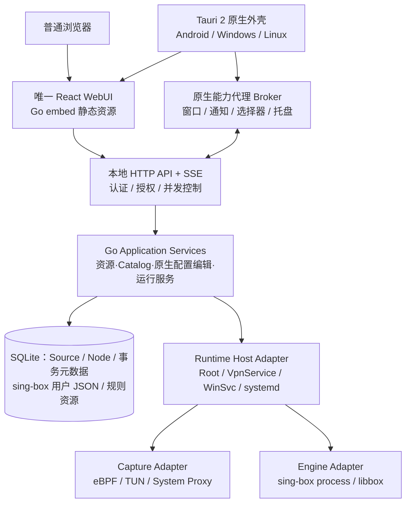
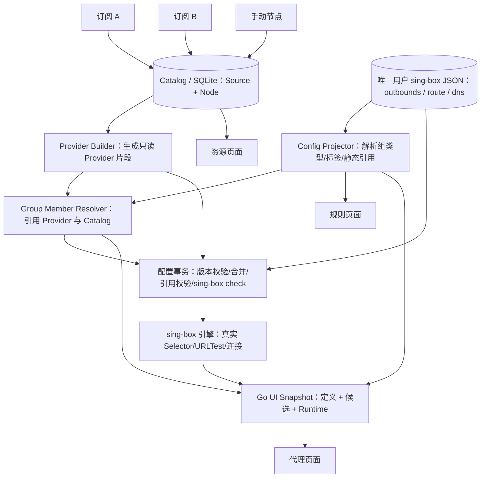
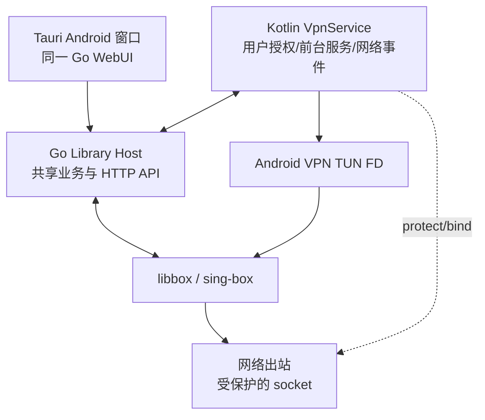

# NetProxy 9.0 — 全新架构设计与实施规范

> **文档版本：** 1.2（单一 sing-box JSON 配置 / Catalog → Provider → 策略组 / 统一可视化与 JSON 编辑）  
> **制定日期：** 2026-10-10  
> **项目：** NetProxy 9.0  
> **目标平台：** Android / Windows / Linux  
> **技术路线：** Go Core · Go 内置 WebUI · React · Tauri 2 · sing-box  
> **定位：** 全新产品架构设计，不是 NetProxy 8.x 的移植或兼容升级指南。

---

## 0. 执行摘要与架构决议

**NetProxy 9.0 是一次允许破坏性变更的全新架构重构。** 不继承旧版内部 API、CLI、文件目录、数据格式、进程模型、应用界面或历史数据迁移要求。8.x 只作为功能体验与问题案例的参考，不是设计约束。既有代码可用则用，不优则弃，不以代码复用率评估重构成功。

本方案确立：

1. **Core-first：** Go Core 是唯一通用业务入口与配置事务协调者，负责 Catalog、订阅、原生配置的校验编辑、运行编排、管理 API 与可观测性；策略组与路由的**持久配置事实源仅为一份 sing-box JSON**。
2. **Embedded WebUI：** 唯一完整 React WebUI 打包到 Go Core，独立浏览器和 Tauri 使用同一份服务端 UI；不维护第二套业务页面。
3. **Thin Native Shell：** Tauri 2 负责 Android、Windows、Linux 的应用外壳、系统窗口与受限原生能力，**不是代理存活的前提**。
4. **平台最适化：** Android Root、Android 无 Root VPN、Windows、Linux 可以采用不同的数据面、权限和进程部署模型，禁止为“形式统一”牺牲系统正确性。
5. **安全默认闭合：** 本地管理 API 即使监听 loopback 也需鉴权；Web 页面不直接获得任意 Root、Shell、系统文件权限。
6. **明确不兼容：** 不提供 8.x 配置解析器、自动迁移、升级兼容层或双格式维护。9.0 从全新数据空间初始化；不对历史安装作无损升级承诺。
7. **简单优先、单一配置：**「代理」展示原生 JSON 定义的策略组；「资源」管理订阅、手动节点与 Catalog；「规则」编辑同一 JSON 的路由。**不区分 Managed / Expert 模式，不创建独立 Policy Store，也不维护第二份策略组或路由定义。**
8. **务实的模块化单体：** 按真实职责划分边界，不引入微服务、动态插件市场、抽象工厂层层套用等无收益设计。

### 0.1 本次设计确定的唯一数据关系

```text
资源：订阅 / 本地节点
         ↓
Catalog：统一节点库（节点事实源）
         ↓
生成的 sing-box Provider（只读派生产物）
         ↓
用户唯一 sing-box JSON：outbounds / route / dns 等
         ↓
Go Core：原生配置解析 / 引用解析 / 严格校验 / 事务提交
         ↓
sing-box 引擎（运行时实际选中、测速、最终出站）
         ↓
「代理」页面：配置定义 + Catalog 成员元数据 + 引擎快照
```

**统一编辑体验：** 新建/编辑策略组和直接编辑 JSON 都是对同一份有效配置作修改；没有“模式切换”“导入策略定义”或“独立策略组同步”步骤。用户未定义的策略组不出现；预置组只能来自新建配置模板，不能写死为页面常量。

**严格区分四类事实：** Catalog 是节点事实源；用户原生 JSON 是策略组/路由配置事实源；生成的 Provider/运行配置是可重建产物；引擎 API 才能证明实时选中和延迟。SQLite 只记录资源元数据、事务版本和通用偏好，不能复制持久策略组或规则。

### 0.2 产品形式

| 产品载体 | 组成 | 核心使用方式 |
|---|---|---|
| Android Root Edition | Root 模块：Go 守护服务 + sing-box；Tauri APK 可选 | eBPF / Root TUN；浏览器或 APK 管理 |
| Android VPN Edition | Tauri APK + Kotlin `VpnService` + Go 原生库 + sing-box/libbox | 无 Root VPN；APK 安装和系统 VPN 授权必需 |
| Windows Edition | 独立 Go 后台服务 + sing-box；Tauri 客户端可选 | TUN / 系统代理 / Mixed，视权限和驱动实现 |
| Linux Edition | 独立 Go Daemon + sing-box；Tauri 客户端可选 | TUN / 系统代理 / Mixed；支持无桌面环境 |
| Browser WebUI | Go Core 内置的 React 页面与同源 HTTP API | 完整通用管理能力，无本机原生增强能力 |

> **重要边界：** 无客户端 ≠ 无核心。浏览器必须连接已经运行的 Go 服务；Android **无 Root VPN** 的 Go 服务由 APK 中的 Android Service 承载，不存在完全不安装 APK 就使用系统 VpnService 的方案。

---

## 1. 非目标：明确不做什么

- 不为 NetProxy 8.x 保留任何字段、API、CLI、配置路径、缓存结构、状态码的历史兼容性。
- 不提供旧配置自动迁移、旧数据库升级适配、旧 APK 包名/签名升级连续性保证。
- 不为兼容旧 Compose 管理器而设计 9.0 通信协议；全新业务 UI 以 React 重建。
- 不把 Tauri 客户端视作管理后台的唯一宿主，也不让关闭窗口停止网络代理。
- 不为了“Go 单进程”把所有平台强制改成进程内 sing-box；进程内/进程外以系统场景择优。
- 不在首次发布就承诺跨设备远程控制、云账户同步、每个平台一致的高级分应用流量识别、所有发行渠道或所有 CPU 架构。
- 不在 9.0 初期引入可替换任意代理引擎的公开插件 ABI；只建立最小的 sing-box 适配边界。
- 不建立任意命令远程执行接口；管理 API 只暴露经过定义和校验的业务操作。
- 不提供 Managed / Expert 两套配置模式、独立 Policy Store、PolicySelection 数据库表或双向 JSON 同步；不因用户使用可视化或 JSON 编辑器而切换数据语义。

## 2. 总体架构



### 2.1 五条不可跨越的职责线

| 层 | 应拥有的内容 | 绝不能拥有的内容 |
|---|---|---|
| UI（React） | 页面、交互状态、可视化、输入校验、能力降级呈现 | 订阅事实源、真实服务状态、系统命令拼接 |
| Transport（Go） | HTTP/CLI 接入、认证、授权、参数校验、事件推送 | 领域决策和重复业务流程 |
| Application / Domain（Go） | 业务用例、状态机、策略、配置生成与事务 | Android/Win32 专用代码、窗口/UI 控制 |
| Runtime / Engine / Capture（Go + 平台代码） | 进程、网络接管、TUN、socket 保护、核心状态 | Catalog 数据模型、订阅解析规则的副本 |
| Native Shell（Tauri + Kotlin/Rust） | OS 交互、权限引导、通知、托盘、文件选择 | 第二套业务数据库、第二套节点/订阅实现 |

原则：**一个业务操作只有一个 Application Service 入口**，不允许 HTTP、CLI、Tauri 各自另写业务实现。

---

## 3. Go Core 的全新内部设计

### 3.1 采用模块化单体

建议使用“领域 + 用例 + 基础设施”三层，而非按 HTTP/Android 入口组织全部业务文件。

| 业务域 | 关键职责 | 单一事实源 |
|---|---|---|
| Profile | 可选的完整原生配置档案与当前活动档案切换；每个活动档案只有一份原生 JSON | 档案文件 + 活动档案指针 |
| Resource / Catalog | 统一节点实体、来源归属、手动节点、查询与元数据；不负责决定当前代理出口 | Core DB（Source / Node） |
| Subscription | 获取、转换、更新、有效性检验与来源快照提交 | Core DB（Subscription / Source） |
| Group Projection | 从 `outbounds` 读取 `selector` / `urltest`，解析 Provider / 节点及嵌套关系，生成 UI 只读投影与诊断 | sing-box 用户 JSON（定义）+ Catalog（成员）+ 引擎 API（运行态） |
| Routing | 可视化编辑同一 JSON 内的 `route`、`dns`、`rule_set`，验证所引用的 outbound tag | sing-box 用户 JSON |
| Runtime | 服务状态机、运行计划、启动/停止/重载、故障恢复 | 运行时状态机 + OS/引擎观测 |
| Telemetry（可选） | 本地运行统计、诊断导出 | 隔离存储；默认不上传外部服务 |

不把 `EngineAdapter`、`CaptureAdapter` 做成过度通用的复杂插件系统；只有第二种真实实现需要差异时才扩展接口。

### 3.2 控制面与数据面分离

- **控制面（Control Plane）：** 管理配置、节点、订阅、策略、服务状态、HTTP API、CLI 与 WebUI。
- **数据面（Data Plane）：** TUN/eBPF/系统代理捕获流量，交给 sing-box 解析规则、处理 DNS 与出站连接。
- **状态机（Runtime Coordinator）：** 负责把“期望状态”收敛为“可验证的实际运行状态”。

Go Core 不自己重新实现通用 TCP/IP 代理栈；优先复用 sing-box 的成熟流量处理能力。

### 3.3 Runtime Host、Capture、Engine 是三个维度

不再出现“`backend=ebpf/tun/vpn` 决定整个系统行为”的单一大枚举。

```text
Runtime Host（谁负责存活与权限）
  ├── android-root
  ├── android-vpn
  ├── windows-service
  └── linux-daemon

Capture（流量怎样进入代理引擎）
  ├── ebpf
  ├── tun
  ├── android-vpn-tun
  ├── system-proxy
  └── mixed-listener

Engine（流量由谁解析与转发）
  ├── sing-box-process
  └── sing-box-libbox
```

**允许组合必须由平台能力注册表验证**，而不是将任意 Host × Capture × Engine 组合全部视作合法。

例如：`android-vpn + ebpf` 不合法；`android-vpn + android-vpn-tun + libbox` 合法；Windows 默认不能借用 Android 的包名/UID 规则。

### 3.4 核心状态机与错误语义

```text
stopped → preparing → starting → ready
    ↑          │          │       │
    └──────────┴─ failed ←────────┘
                              │
                         stopping → stopped
```

- `desired_state` 表示用户意图；`observed_state` 表示当前真实状态；两者不能混用。
- 只有实际引擎就绪、预期接管方式验证成功，才能进入 `ready`。
- 服务启动失败不静默切换成另一个 Capture，也不悄悄改写用户配置。
- 每次实例使用运行 ID / generation，防止旧事件覆盖新实例的状态。
- 所有修改操作提供操作 ID；重复请求可幂等，取消与超时语义明确。
- 失败时优先保留最后一次有效配置快照，不能写坏当前可运行配置。
- 启动/停止/重载/配置提交在单运行实例内串行；状态快照读取不阻塞长事务。

### 3.5 单一原生 JSON 配置：所有编辑入口对同一文件操作

**9.0 不采用 Managed / Expert 双模式，也不为策略组自创第二份 JSON 数据模型。**

- **唯一用户可编辑的引擎配置：** `config/sing-box.json`（概念路径，最终可调整）。`outbounds` 的 `selector` / `urltest` 定义策略组，`route` 定义分流，`dns` 定义 DNS；这是策略组、分流与引擎参数的唯一持久配置事实源。
- **Catalog：** SQLite 保存 Source、Subscription、Node 等资源数据。它负责“有哪些节点”，不负责“有哪些策略组”。
- **Provider：** Go Core 根据 Catalog 的活动修订生成只读 Provider 快照供 sing-box 引用；它是派生产物，不是用户另一个可编辑配置系统。
- **平台注入：** Runtime Host 根据 Android Root/VPN、Windows 或 Linux 的能力生成所需 `inbounds` 和少量运行参数。生成内容不覆盖用户的原生策略组/规则。
- **有效运行配置：** `effective = 用户 sing-box JSON + 生成的 Provider + 平台运行时片段`。合并前执行标签冲突、引用、权限与能力检查，再交 sing-box 验证。
- **共同编辑入口：** 代理页表单、规则页表单和设置里的 JSON + Schema 编辑器使用同一个配置事务 API，并以 revision / ETag 做乐观并发控制；**禁止相互覆盖和吞掉未知字段**。

单一事实源指“用户策略定义只有一份”，不代表所有数据只能存在于一个文件。Catalog、引擎运行状态和平台服务状态依旧拥有各自独立、但职责明确的数据源。

**原生 JSON 中存在尚无可视化编辑器支持的合法字段时：** 页面仍根据原生配置列出该组并展示可解释的成员、状态；编辑器仅改其能正确表达的字段，无法保证无损编辑的对象显示“在 JSON 编辑器中修改”。**不能删除未知字段，不暴露模式开关。**

**选择持久化：** 手动 `selector` 切换调用引擎 API；sing-box 在启用 `experimental.cache_file.enabled` 时按当前版本机制缓存选择。`default` 是组的原生默认值，**不是当前已选出口的实时事实**。Core 不创建独立的 PolicySelection 表；启动时按引擎实际回报显示选择，停止时只显示配置默认值或“上次观测（历史）”，绝不标成在线实况。

**标签引用：** 原生 `tag` 是引擎配置引用键。建议生成的 Provider / 节点 tag 使用稳定、保留前缀（如 `np/node/...`），以减少订阅改名导致的引用失效。用户重命名策略组 tag 时，Go Core 必须在同一事务检查并更新所有已知 `outbounds` / `route` / `dns` 引用；无法无损完成时拒绝自动重命名并提示使用 JSON 编辑器。**不要虚构数据库里的 `policy_id` 与原生 tag 的独立双向映射。**

**首次运行：** 可从模板初始化一份带有 `Proxy` / `Auto` / `direct` 等出站的原生 JSON；这是一次性创建文件，不是页面内固定策略组，也不会按每份订阅自动产生 `Auto/<订阅>` / `Select/<订阅>`。

## 4. 全新持久化设计

### 4.1 默认选择

- **SQLite：** Source、Subscription、Catalog Node、资源修订、配置文档版本/事务元数据、任务状态、通用 UI 偏好；**不保存 PolicyGroup / PolicySelection / RoutingRule 的第二套配置副本**。
- **文件系统：** 唯一用户原生 sing-box JSON（策略组、路由、DNS），较大的规则资源、导入原文件、诊断包、只读生成的 Provider 与有效运行配置快照。
- **系统密钥存储 / 受限文件：** API 凭据、会话密钥、可能包含敏感内容的密钥材料；Android VPN App 可使用 Android Keystore 等系统能力，Root/桌面环境按实际权限隔离设计。
- **单写入所有权：** 当前活动实例由一个 Core 写入；Android Root 和 VPN 运行载体各有独立数据空间，禁止同时修改同一个 SQLite 文件。

### 4.2 持久化保证

1. 代理表单、规则表单和 JSON 编辑器统一读取同一份原生 JSON，并用 revision 检测冲突；变更先结构校验、引用校验、`sing-box check` 再原子提交，不能出现“DB 指针已改、运行文件只写一半”。
2. 运行时资源使用 staging → 校验 → 原子发布；异常终止后可清理或恢复到最近有效快照。
3. 数据库资源修订、用户 JSON 保存和引擎热重载无法由单个 ACID 事务覆盖，需用准备/发布/生效确认阶段进行协调，明确区分“保存成功”与“运行中已应用”。
4. 敏感信息不出现在默认日志、URL 查询参数、遥测事件和诊断包中。
5. 用户显式导出/备份是当前产品功能，不代表承诺导入 8.x 数据；**不提供旧版自动迁移**。

### 4.3 版本与兼容策略

- 9.0 内部契约重新定义，不继承 `schema=1` 的历史兼容要求。
- Go 内置 UI 与当前 Go API **同包构建**，避免前后端版本漂移。
- Tauri 连接 Core 时必须完成协议能力握手；不兼容就拒绝高风险操作并提示更新，不增加兼容逻辑。
- 在新版实现中使用版本号用于检测和拒绝不匹配，**并不等同于支持历史版本兼容**。

---

## 5. 管理 API 与实时状态

### 5.1 技术决策

- 默认 **本机 HTTP/JSON API**；WebUI 与 API 同源。
- **SSE** 用于状态、流量、日志等服务器单向推送；只有明确需要双向高速消息流才引入 WebSocket。
- **CLI** 复用相同 Application Services；如需跨权限控制，可通过本地认证 IPC 代理，而不是直接复制业务处理逻辑。
- 本地服务优先 loopback 监听；未来若开放 LAN/远程访问，必须独立设计 TLS、配对及授权，不作为 9.0 首发默认功能。

示例接口（**全新协议草案，非已实现 API**）：

```http
GET    /api/system/manifest
GET    /api/runtime/status
POST   /api/runtime/start
POST   /api/runtime/stop
POST   /api/runtime/reload
GET    /api/profiles
POST   /api/profiles
GET    /api/resources/sources
GET    /api/catalog/nodes
GET    /api/proxies/groups             # 从 JSON 构建的策略组投影
POST   /api/proxies/groups             # 受控编辑唯一原生 JSON
GET    /api/proxies/groups/{tag}/members
POST   /api/proxies/groups/{tag}/select
GET    /api/routing/rules              # 解析 JSON route
POST   /api/subscriptions/refresh
GET    /api/config/source               # 唯一原生 JSON + revision
PUT    /api/config/source               # 替换前完整校验 + revision
GET    /api/config/effective            # 只读有效合并结果
POST   /api/config/validate
GET    /api/events                 # SSE
GET    /api/platform/capabilities
```

建议返回结构：

```json
{
  "ok": true,
  "data": { "state": "ready", "generation": "example-id" },
  "error": null,
  "request_id": "example-request-id"
}
```

错误 `code` 稳定、`message` 面向用户、`details` 面向诊断；敏感详细错误不能直接原样暴露给网页。

### 5.2 API 身份与授权

**Loopback 不是安全边界。** Android 本地其他 App、桌面本机其他进程，以及恶意网页都可能尝试请求本地监听端口。

最低要求：

- 未验证身份的客户端不得修改状态或读取包含凭据的配置。
- WebUI 通过专用登录/解锁流程建立短生命周期会话；优先 `HttpOnly` 会话 Cookie + CSRF 防护；HTTPS 部署使用 `Secure` 属性。
- 校验 `Host` 和 `Origin`，限制跨域请求，阻止 DNS rebinding 和不可信站点跨站调用。
- 禁止将高权限长期令牌放在 URL、localStorage 或静态 Web 资源中。
- 本地首次信任建立使用操作系统可信通道（例如 CLI 一次性配对码、私有 IPC、服务安装时配置的凭据）。
- 敏感操作需要操作级授权；锁定浏览器来源、Tauri 来源、CLI 来源各自的能力范围。
- 仅在显式设置后允许远程访问；此时应改用 HTTPS 与设备级凭证，并重新进行安全审计。

---

## 6. Go 内置 WebUI

### 6.1 确定技术栈

| 部分 | 选择 | 原因 |
|---|---|---|
| UI 框架 | React + TypeScript | 业务组件共享、类型约束明确 |
| 构建 | Vite | 静态产物易内置 |
| 组件 | shadcn/ui + Tailwind CSS | 可控源码与跨端响应式设计 |
| 服务端数据 | TanStack Query | 缓存、失效、错误与重试策略 |
| 轻量 UI 状态 | Zustand | 不把服务端事实源复制到前端 |
| 表单 / 校验 | React Hook Form + Zod | 交互体验与输入校验 |
| 编辑器 | Monaco 或 CodeMirror 6（按移动端性能验证选型） | JSON + Schema、语法提示 |
| 图表 | ECharts / uPlot（二选一，基准测试决策） | 实时流量可视化 |

前端不要以框架数量作为“现代化”的指标；仅引入被真实功能使用的依赖。

### 6.2 Go embed

流水线：

```text
React 源码 → Vite 构建 dist/ → Go //go:embed → Core 二进制/原生库
                                                    ↓
                                         HTTP 静态资源 + API
```

- `/` 返回单页应用；`/assets/*` 使用哈希文件名与长期缓存；`index.html` 短缓存。
- 资产内置在服务端，Tauri 不复制业务 React 页面。
- 资源离线可用：不把 CDN 字体、图标、JS 作为必需依赖。
- Android VPN 版的 Go 原生库中可以包含 WebUI 静态资源，由 VPN Service 的生命周期内本地 HTTP 服务提供；是否独立保持 HTTP 服务由原生 Service 状态机决定。

### 6.3 浏览器与 Tauri 表现

**浏览器与 Tauri 获得完全相同的通用业务功能。** 差别仅在平台原生增强：

| 功能 | Browser | Tauri |
|---|---|---|
| 代理策略组、资源/Catalog、订阅、规则、原生 JSON、服务操作 | Go API 完整支持 | 相同 Go API |
| 日志、流量、连接可视化 | 支持 | 支持 |
| Go 能查询到的应用列表 | 支持 | 支持，可增强图标与选择器 |
| 系统托盘 / 全局快捷键 | 不提供 | 平台支持时提供 |
| Android VPN 授权 | 浏览器可提示用户切换 App | Kotlin 原生授权流程 |
| Android 快捷设置磁贴 | 不提供 | Kotlin Android 组件 |
| 文件导入/导出 | 浏览器选择/下载 | 可使用原生文件对话框与分享 |
| 通知 | 浏览器权限限制 | 系统原生通知 |

**能力声明而非页面分叉：** Go Core 返回 `core_capabilities`，Tauri Broker 返回 `native_capabilities`。React 根据能力决定按钮/交互；不能把缺失原生能力当作业务核心不可用。

---

## 7. 「代理 / 资源 / 规则」与单一配置架构

> **本章为 v1.2 核心变更：** 删除 Managed / Expert、Policy Store、独立 PolicyGroup / PolicySelection / RoutingRule 持久表。NetProxy 不让用户选择“配置模式”。用户只面对「代理」「资源」「规则」和需要时可用的原生 JSON 编辑器。

### 7.1 页面导航与职责

| 一级页面 | 用户看到什么 | 编辑的事实源 | 运行状态补充来源 |
|---|---|---|---|
| **概览** | 服务、流量、常用策略组、当前网络接管方式 | 配置入口通过公共 API | Go Runtime + sing-box |
| **代理**（原“节点”） | 从配置自动列出的策略组、组成员、当前选择、延迟与实际出口 | **同一份 sing-box JSON 的 `outbounds`** | Catalog 成员映射 + sing-box API |
| **资源**（原“订阅”） | 订阅、本地节点、全部节点 | **Catalog/Subscription 资源存储** | 测速/下载任务状态 |
| **规则** | 域名、规则集、应用相关条件 → 目标出口 | **同一份 sing-box JSON 的 `route` / `dns`** | 平台支持能力 + 连接诊断 |
| **设置** | DNS、引擎、流量接管、原生 JSON + Schema、服务安全 | **同一份 JSON** + 独立平台设置 | 宿主与引擎状态 |

移动端优先底部导航，桌面端侧边栏，**两端使用同一 React 页面**。资源页用「订阅」「本地节点」「全部节点」分类；Catalog 仍然存在于 Go 内部，但用户看见的是“节点库”，不用理解 Go 的包名。

**页面不内置任何固定组卡片：** 主列表由有效原生配置 `outbounds` 中的组类对象生成。没有组就出现空状态和「新建策略组」，不会因为 Catalog 有订阅就强行新增策略组。首次模板是文件内容，不是前端硬编码。

### 7.2 唯一数据关系：谁保存、谁生成、谁展示



UI 快照是配置与运行状态的组合视图，不是持久化的第三份配置。

| 对象 | 事实源 | 说明 |
|---|---|---|
| 订阅、节点、协议参数、来源 | Catalog + Subscription Store | 持久资源数据，允许 CRUD/刷新，与组定义无关 |
| 策略组列表、名称、类型、成员筛选、默认成员 | sing-box 用户 JSON 的 `outbounds` | **唯一组定义；绝不另建 Policy Store** |
| 路由条件、目标出站 | 同一 JSON 的 `route` / `dns` | 规则页与 JSON 编辑器修改同一对象 |
| Provider 及节点运行 tag | Core 从 Catalog 生成的只读快照 | 可删除重建，不能反向变成用户配置事实源 |
| Selector 已选项、URLTest 结果、运行时候选 | sing-box API | 仅引擎在线且 generation 匹配时标为实时 |
| 节点来源/协议/名称等增强元信息 | Catalog 映射 | 仅负责 UI 信息与配置候选引用，不负责决定有哪些组 |
| 展开状态、搜索过滤等 UI 偏好 | UI/轻量配置 | 不参与 sing-box 路由，不能成为第二份组定义 |

**一份用户 JSON 并不意味着运行时只能加载一个文件。** Core 可生成 Provider、平台入站等只读片段，与用户 JSON 组成有效配置；但所有**用户可编辑的策略组与规则**只存在于原生 JSON。

### 7.3「代理」列表如何绘制？

1. Core 读取当前唯一用户 JSON（在可编辑状态下可读取未启动的有效配置）；遍历 `outbounds`，挑出目标版本支持的 `type=selector`、`type=urltest`。名称与可引用键直接来自 `tag`。
2. 按 `outbounds` 中的声明顺序展示（用户拖动排序可以提交 JSON 数组变更）；前端单独保存折叠、搜索、置顶等纯展示偏好。
3. 从原生字段读取 `outbounds`、`providers`、`use_all_providers`、`include` 等引用/筛选信息，按当前选定的 reF1nd 构建版本做严格解析；**字段名/语义必须以该版本 Schema 和实际接口为准**。
4. Core 将 Provider 成员与 Catalog 的 Node ID、来源、协议元数据做映射，得到可供 UI 展开的列表；嵌套子组保留为组，不盲目拍平为节点。
5. 若引擎运行，从 Service API 查询选中项、URLTest 检测结果和实际出站，并用 generation 对齐；离线则只显示静态定义、候选、配置默认值。
6. 列表 API 返回**聚合投影**，不把投影重新保存为 PolicyGroup 数据库表。

**举例：** 用户 JSON 声明「默认代理」「香港节点」「AI」，代理页就出现这三组；即使 Catalog 有 12 个订阅，也不自动出现 24 个 Auto/Select 卡片。反之，JSON 没有 AI，页面也不会凭空出现 AI 组。

#### 代理页信息结构

```text
代理                                          [+ 新建策略组] [全部测速]
[搜索组] [Selector] [URLTest] [错误/警告筛选]

默认代理    Selector     选中：香港节点 → 实际：香港 03
  ├─ 香港节点     URLTest     实际：香港 03（示例 86ms）
  ├─ 美国节点     Selector    选中：美国 02
  └─ direct
AI          Selector     选中：美国节点 → 实际：美国 02
香港节点    URLTest      候选 18    实际：香港 03
```

每个组显示：`tag`/组名、组类型、成员数量、选中成员、最终出口、有效延迟与测速时间、运行/警告状态。展开后展示子策略组、具体节点及来源。静态 `default`、引擎实际 `selected`、递归解析的 `effective_outbound` 必须分开。

**详情页：** 「成员」（引用和候选、来源、协议、测速）；「设置」（原生字段的可视化编辑）；「诊断」（引用链、校验错误、配置修订、引擎 generation）。无法保证无损图形化编辑的扩展字段直接引导至同一 JSON 编辑器，**不出现“专家模式”选项**。

### 7.4「资源」页面：Catalog 如何与策略组关联

| 资源子页 | 管理内容 | 与策略组的关系 |
|---|---|---|
| **订阅** | URL、UA/Headers、更新周期、流量用量、到期、最近状态、查看节点 | 订阅变化更新 Catalog，再重建只读 Provider；不自动创建策略组 |
| **本地节点** | 手动添加、协议编辑、单链接/文件导入、复制/删除/测速 | 进入 Catalog，与订阅节点平等；不必先进入“本地组”再选择 |
| **全部节点** | 全来源查询、搜索、排序、来源和协议过滤、节点引用反查 | 可被固定 outbound 引用，也可被 Provider 筛选组动态引用 |

Source/Node 使用稳定 ID；Provider Builder 建立稳定 node tag（建议保留 `np/node/` 命名空间）。名称改动不必影响 tag；节点确实被删除时显示引用错误，不能悄悄改成 `direct`。

**资源刷新流程：** Source Parser → 校验资源 → Catalog 新修订 → 生成 Provider → 解析所有受到影响的策略组 → 校验有效配置 → 原子发布并加载。失败保留最后有效运行 generation，同时明确告知来源刷新和引擎应用是否分别成功。

对于动态筛选（如 `use_all_providers` + `include`），新节点可能自动进入已有组；对于固定 `outbounds` 节点引用，新增节点不会自动进入列表。**这两种行为来自 sing-box JSON 原生配置，不存在 NetProxy 自创的第三种查询配置。**

### 7.5 原生 sing-box JSON 例子：从 Catalog Provider 收集节点

以下仅演示策略组部分，`providers` 由 NetProxy 根据 Catalog 另行生成；字段 `use_all_providers` / `include` 为 NetProxy 目标 reF1nd 构建中的扩展能力，**必须以 P0 选定版本的真实 Schema 与 `sing-box check` 验证，不能无条件套用到上游 sing-box**：

```json
{
  "outbounds": [
    {
      "type": "selector",
      "tag": "默认代理",
      "outbounds": ["香港节点", "AI", "direct"],
      "default": "香港节点"
    },
    {
      "type": "urltest",
      "tag": "香港节点",
      "use_all_providers": true,
      "include": "(?i)(香港|Hong Kong|HK|🇭🇰)",
      "url": "https://www.gstatic.com/generate_204",
      "interval": "3m",
      "tolerance": 50
    },
    {
      "type": "selector",
      "tag": "AI",
      "outbounds": ["美国节点", "direct"],
      "default": "美国节点"
    },
    {
      "type": "selector",
      "tag": "美国节点",
      "use_all_providers": true,
      "include": "(?i)(美国|United States|US|🇺🇸)"
    }
  ],
  "route": { "final": "默认代理" }
}
```

**这是局部示例，不是可直接启动的完整 sing-box 配置。** 实际还需对应 `direct`/可能的服务配置、Provider、必要的 DNS/入站、平台运行参数，并符合当前引擎版本。正则只是名称过滤，不代表真实地理位置。

在这个例子里：

- 页面会显示 `默认代理`、`香港节点`、`AI`、`美国节点` 四个策略组；**数据完全来自 JSON 的四个声明**。
- `香港节点` 解析 Provider 后，成员可能包含不同订阅的香港节点。Catalog 仅给节点来源、协议和稳定 tag。
- `AI` 引用 `美国节点` 这个子策略组；切换 `AI` 的成员只是操作 sing-box Selector，不修改某个独立 PolicyStore。
- 规则页更改 `route.final` 为 `AI`，修改的仍是**同一份 JSON**。

### 7.6 可视化编辑与 JSON 编辑器：完全相同的配置事务

```text
代理页「+ 新建策略组」 ─┐
代理页「编辑策略组」   ─┤
规则页「修改目标组」   ─┼─> Go Config Editor（同一事务入口）
设置页「JSON + Schema」─┘             │
                                     ▼
                         读取当前用户 JSON + revision
                                     ↓
                         原位修改目标字段，保留其他字段
                                     ↓
                         原生 Schema + 引用/环/标签校验
                                     ↓
                          组合 Provider / 平台片段
                                     ↓
                               sing-box check
                                     ↓
                          原子保存 JSON + 发布快照
                                     ↓
                           引擎热重载 / 状态确认
```

**可视化编辑器必须尊重原生 JSON：**

- 新建策略组等同于向用户 JSON 的 `outbounds` 添加合法 `selector` / `urltest`，不能在 SQLite 同时创建 PolicyGroup 对象。
- 删除/改名先检查子组、路由、DNS 等引用，允许受控更新，但不能丢弃未知字段或默默修正用户输入。
- 部分字段暂不支持表单编辑时，保留字段原样并提供 JSON 编辑器，而不是进入另一种工作模式。
- 并发编辑使用 `revision` / `If-Match`，检测到冲突提示重新载入并比较差异，不静默覆盖。
- 引擎停机也可编辑和验证 JSON；界面不必靠实时 API 才能列出策略组。
- JSON 编辑同样走完整校验与事务。**一份配置、两个视图、一个提交路径**。

### 7.7 映射与运行态：三个容易误解的状态

| UI 字段 | 从哪里来 | 如何显示 |
|---|---|---|
| **配置默认选项** | 用户 JSON 里 `selector.default`（如果配置） | “默认：香港节点”；不代表当前实际选中 |
| **实际选中成员** | sing-box API（`SubscribeGroups` / `SelectOutbound` 关联状态） | “已选：香港节点”；停机显示不可用 |
| **实际最终出口** | 使用同一代引擎快照递归展开子组，查到节点或 `direct` | “香港 03”；无法确认则显示“未知” |
| **延迟/测速时间** | 引擎 URLTest/API 或带来源及时间的 Core 测速缓存 | “86ms · 15:20 测得”；未测不显示 0ms |
| **节点信息** | Provider tag ↔ Catalog Node ID 映射 | 显示“来自订阅 B · VLESS” |

**选择不是策略组配置重写：** 用户点击成员时调用 sing-box 选择 API，确认成功后刷新运行状态。sing-box `experimental.cache_file.enabled` 在受支持版本中保存 Selector 已选项，无需自建 PolicySelection 数据表；原生 `default` 字段仍然是初始回退默认，而非每次点击都写回 JSON。内核未运行时不能执行“已经切换”的假成功。

**离线显示：** 依然可打开策略组列表、编辑组和查看静态成员；实时选中、出口、测速标为“未运行/未知”，可另行展示带时间戳的历史测量，但不能冒充实时数据。

### 7.8 组引用、错误与复杂度控制

- **策略组引用键：** 原生 JSON `tag` 是唯一键；组/规则使用同一个 tag 引用。使用受控改名更新已知引用，无法保证完整时拒绝。
- **节点引用键：** Catalog 生成 Provider 内部唯一、稳定的运行 tag，尽量不依赖节点展示名；避免不同订阅同名节点发生 tag 冲突。
- **动态筛选：** 按引擎真实支持的 `providers` / `use_all_providers` / `include` 或其他版本字段解释；动态成员随 Catalog 变化重新解析，不把当前结果写回用户 JSON。
- **嵌套：** 禁止组环（A→B→A），限定解析深度和列表规模；对实际引擎支持语义进行检查。
- **删除资源：** 检测会失效的固定引用；不静默改为 `direct`。对空组、过期成员、不可用 Provider 显示可操作的错误信息。
- **完整性：** JSON 原生 tag 必须全局有效、引用存在、无危险覆盖；如未知/扩展对象无法无损修改，受控编辑拒绝并要求用户通过 JSON 修改。
- **生成结果：** Core 只维护一个有效运行 generation，`effective config`/Provider 是只读可重建缓存；不允许用户直接改生成文件作为持久修改。

### 7.9 最小 API 设计（草案）

```http
# 唯一用户 JSON：所有可视化编辑/手写编辑的共同基础
GET    /api/config/source                    # 返回 JSON、revision / ETag
PUT    /api/config/source                    # 完整替换、校验、原子保存
POST   /api/config/validate                  # 只验证候选 JSON + 资源引用
GET    /api/config/effective                 # 只读，当前有效合并配置

# 代理：这些端点只对同一份 JSON 作受控编辑 / 运行态操作
GET    /api/proxies/groups                   # 返回配置组投影 + 运行摘要
GET    /api/proxies/groups/{tag}             # 组原生字段 + 增强元数据
POST   /api/proxies/groups                   # 新建 → 追加 outbounds[]
PATCH  /api/proxies/groups/{tag}             # 修改 → 定点 JSON 更新，带 If-Match
DELETE /api/proxies/groups/{tag}             # 删除 → 检查已知引用
GET    /api/proxies/groups/{tag}/members     # 引擎候选 + Catalog 映射
POST   /api/proxies/groups/{tag}/select      # 引擎在线时即时选择
POST   /api/proxies/groups/{tag}/test        # 测速任务（按引擎能力）
GET    /api/proxies/groups/{tag}/runtime     # 实际选中、延迟、最后出口

# 资源 / Catalog
GET    /api/resources/sources
POST   /api/resources/sources
GET    /api/resources/subscriptions
POST   /api/resources/subscriptions/{id}/refresh
GET    /api/catalog/nodes?source_id=&protocol=&q=&cursor=
GET    /api/catalog/nodes/{id}
GET    /api/catalog/nodes/{id}/group-references

# 规则：修改的仍是唯一用户 JSON 的 route/dns
GET    /api/routing/rules
POST   /api/routing/rules                   # 受控更新 JSON + If-Match
GET    /api/events                          # SSE：config/catalog/runtime/test
```

建议 UI 快照结构（示意；不是当前 sing-box API 原始响应）：

```json
{
  "tag": "AI",
  "type": "selector",
  "config_revision": 12,
  "catalog_revision": 43,
  "configured_members": ["美国节点", "direct"],
  "resolved_members": [
    { "kind": "group", "tag": "美国节点" },
    { "kind": "builtin", "tag": "direct" }
  ],
  "default_member": "美国节点",
  "runtime": {
    "available": true,
    "generation": "runtime-005",
    "selected_member": "美国节点",
    "effective_outbound": "np/node/subB/node02",
    "effective_outbound_display": "美国 02",
    "updated_at": "2026-10-10T07:00:00Z"
  }
}
```

事件语义：`config.changed`（唯一 JSON 修订）、`catalog.changed`（资源修订）、`runtime.groups.changed`（选择/测速）。SSE 重连后按配置与 Catalog revision 重取快照，防止旧 runtime generation 错配。

### 7.10 组类型范围与系统默认行为

| 类型 | 9.0 首发目标 | 运行机制 |
|---|---|---|
| Selector | 必做 | sing-box `selector`，API 即时选择 |
| URLTest | 必做 | sing-box `urltest`，引擎周期测速 |
| 嵌套组 | 必做 | 原生出站引用，递归诊断但不重复保存组对象 |
| Fallback | 仅在引擎明确支持时做 | 不用 Go 控制面伪装数据面故障切换 |
| LoadBalance | 仅在引擎明确支持时做 | 不虚构多连接分发或聚合能力 |

**默认初始化规则：** 可以提供简单实用的原生 JSON 模板，但模板之外的组必须由用户新建或直接写入 JSON。不要根据 Catalog 的订阅目录动态创建 `Auto/<订阅>` 与 `Select/<订阅>`。用户可以增删、改名、排序全部组。

**唯一交互心智模型：** 资源添加节点 → 代理管理策略组 → 规则选择策略组；需要细粒度控制时打开同一份 sing-box 原生 JSON。**没有配置模式切换，没有 Policy Store，没有需要同步的第二套策略组。**

## 8. Tauri 2：只做可选原生外壳

### 8.1 唯一职责

1. 打开窗口并显示 Go Core 提供的 UI。
2. 发现、连接、验证正在运行的 Core；离线时显示轻量本地启动/错误页。
3. 提供托盘、文件选择、通知、深度链接、快捷设置、Android 系统授权等平台能力。
4. 必要时协助启动/停止对应平台的宿主服务，但不持有节点、订阅、配置的第二套状态。

在 Windows/Linux，Tauri 可连接已经由系统服务管理的 Core；不应把“关闭窗口”绑定成“杀死服务”。在 Android Root 模式下，Go Core 由 Root 模块管理；Tauri APK 是可删除的管理外壳。

### 8.2 原生插件规划

| 模块 | Android | Windows | Linux |
|---|---|---|---|
| Shell / Window | WebView、导航、Insets | 窗口、单实例、托盘 | 窗口、桌面适配、托盘（视环境） |
| Notification | Kotlin 通知权限与渠道 | Windows Toast | 桌面通知 |
| File Bridge | Storage Access Framework / 分享 Intent | 文件对话框/关联 | 文件对话框/关联 |
| App Catalog | PackageManager、多用户环境 | 程序元数据（后续） | 桌面条目/进程（后续） |
| VPN Controller | VpnService prepare/start/stop/revoke | 不适用 | 不适用 |
| Quick Actions | Quick Settings Tile | Tray/快捷键 | Tray/快捷键 |
| Privilege UI | Root 状态与授权引导 | 管理员权限/服务安装 | polkit / sudo 引导 |

并非每个插件都必须以 Rust 实现。Android 专属能力使用 Kotlin；Windows/Linux 以 Rust/系统 API 实现。**一项功能在哪个语言最可靠，就写在哪个语言。**

### 8.3 关键安全决策：不默认给远端页面 Tauri 高权限

Tauri 的默认权限面向应用内置资源；Go 的 `http://127.0.0.1:...` 属于另一个来源。Tauri 官方允许显式向远端 URL 授权命令，但同时警告 Linux/Android 某些 iframe 场景下的来源隔离限制。

**首选方案：Native Broker（无直接高权限 JS Bridge）。**

```text
React WebUI ──已认证 HTTP──> Go Core
                                │
                         受限 Native Intent
                                │
                       Tauri Native Broker
                                │
                    OS API / Kotlin / Rust
```

- Tauri 宿主通过可信本地 IPC / 会话握手识别 Core，注册自己可执行的具体能力。
- WebUI 只请求“选择应用”“打开文件”“显示通知”等类型化业务意图，不直接 `invoke('shell')`。
- Broker 校验调用来自当前可信 Core 实例，限制操作名称、参数、调用时效与本机用户交互；敏感操作要求显式用户确认。
- Native Broker 可以断开，Go Core 的通用业务操作仍然可执行。
- 若 P0 证明某个平台必须使用受限 Tauri remote capability，则只给精确 URL / 窗口 / 最小命令集合，且通过 Android/Linux 安全验证；不把 iframe 方案视为天然隔离。

> 这是目标架构设计，不是声称现有 Tauri 已内置这样的 Broker。其 IPC 机制、身份凭据和生命周期是 P0 必须验证的技术决策。

---

## 9. Android 双运行模式

### 9.1 模式与产品边界

| 项目 | Root Mode | VPN Mode |
|---|---|---|
| 前置条件 | Root 模块/Root 授权 | APK + 用户授权 Android VPN |
| Core 部署 | Root Go 守护进程 | APK 内 Go 原生库 / Service 宿主 |
| Engine 部署 | 独立 sing-box（默认） | 优先 libbox 进程内接入 |
| 数据面 | eBPF / Root TUN | `VpnService` 创建的 TUN |
| 管理入口 | 浏览器 + Tauri APK 可选 | APK 的 Tauri 窗口 + 本机浏览器（服务存活时） |
| 进程生命周期 | Root 服务管理 | Android Service / 前台服务管理 |
| 分应用 | Root 侧 UID/应用能力 | `VpnService.Builder` 按包名包含/排除 |
| 热点/共享设备接管 | Root 能力按实现支持 | 普通 VpnService 不等同于热点透明代理 |

**Root Mode 和 VPN Mode 默认互斥。** 同时安装两种组件并不等于允许同时劫持本机网络。选择运行模式的控制必须拒绝冲突，并在用户确认后先释放旧 Capture，再建立新 Capture。

### 9.2 Android Root Mode

```text
Magisk / KernelSU / APatch
       └── NetProxy Root Host (Go)
                ├── 管理 API + WebUI
                ├── Runtime Coordinator
                ├── eBPF 或 Root TUN Capture
                └── sing-box 独立进程

Tauri APK：连接 Root Host，提供系统窗口和 Kotlin 原生增强
```

设计要点：

- Root 模块完成开机宿主与权限环境，不把全部业务塞进启动 Shell。
- Root TUN 与 eBPF 采用不同 Capture 实现，不伪装成 Android 无 Root VpnService。
- `exec.Command`、cgroup、netlink、Root 系统调用仅出现在该宿主/捕获实现中。
- Root Go HTTP API 不应将任何未受保护的 Shell/文件 API 暴露给同机其他 App。

### 9.3 Android VPN Mode：同源 Go，原生宿主



**实现策略：**

1. 使用 `VpnService.prepare()` 请求用户授权；声明具备 `BIND_VPN_SERVICE` 权限的 Service。
2. 使用 `VpnService.Builder` 配置地址、路由、DNS、MTU、按包名允许/排除应用；`establish()` 获得 TUN FD。
3. 将 FD 经明确的所有权协议传入 Go/libbox，避免重复关闭、悬挂或跨进程误用。
4. 通过平台接口调用 `VpnService.protect()` 或对应的 underlying network binding，避免出站再次进入 VPN 造成流量回环。
5. Kotlin 接管 `onRevoke()`、网络变化、前台通知、系统终止及 Always-on/Lockdown 的兼容行为。
6. Go Library Host 共享 Profile、Catalog、Subscription、原生 JSON 事务、API 实现；不能在 Kotlin 重写这些业务。
7. 在 APK 关闭主窗口后，VPN 服务生命周期仍由 Android 控制；VPN 撤销/系统终止时必须完整释放 Core 与 TUN 资源。

**关键技术风险：** Go Core 当前模型和 libbox 不是“把 CLI 二进制拷贝进 APK 就自然跑起来”。需在 P0 验证 Go 原生库打包方式（gomobile/AAR 或 JNI 方案）、libbox 依赖可构建性、FD 传递、线程与内存边界、socket protect、服务重启。

**禁止不加条件沿用 Linux TUN 配置：** `auto_redirect`、Linux 路由表、Root UID 过滤与 Android `VpnService.Builder` 不是同一概念。配置应由平台 Capability 编译，不能静态强制两套规则一致。

### 9.4 分应用策略的统一表达

统一业务意图可以是 `AppScope`，但平台实现不保证功能对等：

```json
{
  "scope": "selected-apps",
  "applications": ["com.example.app"],
  "platform": "android"
}
```

- VPN：Kotlin 验证 Android 包名后，用 Builder 的 allowed/disallowed 列表实现；变更通常需要重建 VPN 接口。
- Root：通过设备对应的 UID / 用户空间机制应用，支持情况由能力表声明。
- Windows/Linux：第一版不承诺完整分进程流量识别；如未来需要，分别评估 WFP、cgroup、eBPF 或其他有文档依据的技术。
- 应用图标和包名选择器属于客户端体验，不能代替真正的数据面分流实现。

### 9.5 互斥与数据域

- 默认一个活动网络接管控制者；模式切换必须遵守 `stop old → verify released → start new → verify ready`。
- Root 模式与无 Root VPN 模式的权限和数据目录天然不同，**不建立跨旧产品的迁移或向后兼容机制**。
- 即使同为 9.0，两种模式也不共享可写数据库文件；如未来需要用户主动导入导出新格式，按显式操作设计，禁止双写。
- 允许浏览器连接当前可用 Core，但同一设备不应因两个活动 HTTP 服务而误连到非当前控制者。发现、身份和端口关联由握手完成。

---

## 10. Windows / Linux 运行时

### 10.1 Windows

- Go Core 作为可独立安装和运行的 Windows Service（需要服务安装/控制器）；Tauri 是可选界面。
- sing-box 第一版优先独立进程，便于进程隔离、升级和异常恢复。
- 捕获策略分阶段实现：先 Mixed/System Proxy，再 TUN；TUN 具体驱动、权限和 DNS 行为单独做 Windows 真机测试。
- 不把 POSIX signal、`/proc`、Linux cgroup、Android Root 假定为跨平台通用 API。
- Tauri 负责托盘、通知、窗口、快捷操作和安装服务时的权限引导。
- 程序退出、用户注销、系统重启的行为由 Windows Service 配置决定，不由 Tauri 窗口决定。

### 10.2 Linux

- Go Core 默认是独立 Daemon；优先提供 systemd unit，但 CLI 运行不应硬依赖 systemd。
- sing-box 可使用独立进程；保留必要 capabilities、最小权限运行策略。
- 捕获策略支持 Mixed/System Proxy 和有权限的 TUN；Root/eBPF 需要单独核对内核功能与部署前提。
- 支持无图形环境运行；Go 内置 WebUI 与 CLI 不应依赖 WebKitGTK。
- Tauri Desktop 只对有图形环境的机器提供窗口、通知、托盘等体验。

### 10.3 逐平台能力声明

不要在 UI 中把“支持 TUN”偷换成“支持所有透明代理场景”。例如热点共享、UDP、IPv6、按应用、DNS 劫持必须独立做能力检测与测试。

| 能力 | Android Root | Android VPN | Windows | Linux |
|---|---|---|---|---|
| Core / WebUI | 目标支持 | 目标支持（Service 活动时） | 目标支持 | 目标支持 |
| Mixed / System Proxy | 可实现 | 可实现 | 第一阶段 | 第一阶段 |
| TUN | Root TUN | VpnService TUN | 分阶段 | 分阶段 |
| eBPF | Root 专属 | 不支持 | 不纳入首发 | 仅经具体驱动验证后考虑 |
| 按应用 | UID / 包名映射 | Builder 包名名单 | 暂不承诺 | 暂不承诺 |
| 热点/共享网络捕获 | 按 Root 实际能力 | 不承诺 | 不适用该形态 | 按具体网络模式验证 |
| 客户端退出服务继续 | 是 | Service 存活时是 | 是 | 是 |

表中“目标支持”是验收目标，**不代表当前 8.x 或本规划已完成开发**。

---

## 11. 推荐代码组织：从零规划

```text
netproxy/
├── apps/
│   ├── web/                         # 唯一 React WebUI 源码
│   │   ├── src/
│   │   │   ├── app/                 # 路由、入口、布局
│   │   │   ├── features/            # overview / proxies / resources / rules / settings
│   │   │   ├── shared/              # UI / API client / hooks
│   │   │   └── platform/            # capabilities / native-intent client
│   │   └── package.json
│   └── tauri/                       # 三端同一个原生外壳项目
│       ├── src-tauri/               # Rust / capabilities / platform hooks
│       └── android/                 # Kotlin 集成源码，含 VpnService
│
├── core/                             # 新 Go Module
│   ├── cmd/netproxy/                 # daemon / CLI 统一入口（桌面/Root）
│   ├── internal/
│   │   ├── domain/                   # profile / source / catalog / runtime（不建 Policy Store）
│   │   ├── application/              # 业务用例
│   │   ├── storage/                  # Catalog SQLite / 原生 JSON 文件 / 凭据
│   │   ├── configprojection/         # 原生 JSON → 策略组/规则投影与引用检查
│   │   ├── configassembly/           # 用户 JSON + Catalog Provider + 平台运行片段
│   │   ├── runtime/                  # coordinator / engine / capture
│   │   ├── platform/                 # Android / Windows / Linux adapters
│   │   └── transport/                # HTTP / SSE / CLI / native bridge
│   ├── mobile/                       # Android Go library 宿主导出接口
│   └── embeddedui/                   # 内置 web dist 资源
│
├── packaging/
│   ├── android-root/                 # Magisk / KernelSU / APatch 模块
│   ├── windows/                      # Windows 服务与安装包
│   └── linux/                        # systemd / deb / rpm / tarball
│
├── contracts/                        # OpenAPI、事件、能力声明、测试样例
├── docs/
│   ├── architecture/                 # ADR / 安全模型 / 平台矩阵
│   ├── developer/                    # 构建与调试指南
│   └── user/                         # 新版使用手册
├── tests/                            # 集成 / e2e / 平台测试
└── .github/workflows/               # CI / release
```

**目录组织是建议，不是工程质量目标。** 若发现子目录只剩一个文件、或拆分导致双向依赖，应合并。一个完整模块可以先由少数高内聚 package 构成。

---

## 12. 安全与权限模型

### 12.1 信任边界

```text
Internet / 第三方订阅  ← 不可信内容
          ↓
订阅获取 / 转换 / JSON 校验  ← 隔离和大小限制
          ↓
Go Core 已验证业务状态
          ↑
Browser / Tauri WebView       ← 不直接持有系统最高权限
          ↓
受限 Management API          ← 鉴权 + 授权 + CSRF / Origin 检查
          ↓
Runtime Host                 ← Root / VpnService / Service 帐户
          ↓
OS 网络与文件系统              ← 最小权限、明确边界
```

### 12.2 必须落地的防护

- Root 高权限只在必要的宿主操作中存在；不因方便就让 UI 任意执行 Root 命令。
- Android VPN 由系统授权；不可绕过用户对 VpnService 的 consent。
- 订阅、配置导入需要大小上限、超时、URL scheme 白名单、重定向约束和敏感数据脱敏；防 SSRF、路径穿越、恶意订阅输入。
- Core HTTP 服务默认只监听本机；会话凭据短期有效；具有明确的登录、登出与权限撤销流程。
- Tauri 采用最小 capability，原生 Broker 有白名单、操作关联、用户确认和来源校验。
- 严禁在生产 WebUI 添加通用终端执行或任意文件系统读写 API。
- Go 内置 WebUI 使用 CSP、禁用无必要的动态脚本与第三方远程资源。
- 日志、崩溃报告及导出包默认隐去订阅 URL、密钥、节点认证信息、设备标识。
- 升级与安装包提供签名及完整性验证；依赖固定版本、生成 SBOM，按许可证核对第三方源码。
- 默认不开启外部遥测；如做匿名使用统计必须单独设计用户告知和可关闭机制。

### 12.3 VPN 特有测试

- VPN 权限被另一 App 抢占；`onRevoke()` 触发后的资源清理。
- DNS 泄漏、IPv6 失败场景、UDP 回环、QUIC、网络从 Wi-Fi 切换到蜂窝。
- 无 Root 应用权限、前台服务类型、系统省电限制、锁屏与进程回收。
- 按应用名单更新的接口重建、网络断开期间的失败行为及 Always-on VPN。
- 用户选择断线保护 / 非断线保护时的准确行为，不作未经验证的“永不泄漏”承诺。

---

## 13. 可观测性与性能目标

### 13.1 必备监控

| 领域 | 观察值 |
|---|---|
| 控制面 | 请求时延、错误码、提交冲突、后台任务状态 |
| 资源与策略 | 订阅刷新修订、Catalog 快照、原生 JSON 修订、组成员映射/引用错误、实际选择偏差 |
| 服务 | desired/observed 状态、实例 ID、启动耗时、退出原因 |
| 引擎 | CPU、RSS、连接数、吞吐、重载耗时、异常计数 |
| 网络 | TUN 收发、DNS 状态、路由捕获就绪、丢包/重试 |
| 客户端 | Core 连接状态、桥接能力与版本、原生操作失败 |

输出分层结构化日志，并支持脱敏诊断包。诊断信息的采集者是 Core，不由每个平台重新解析文本。

### 13.2 性能原则（以 P0 基准数据制定具体门槛）

- Control Plane 不在请求线程同步完成无上限订阅更新或大型配置编译。
- UI 流量图表使用固定刷新率、增量数据和可见时订阅；隐藏页减少轮询。
- Android VPN 的 socket 回调与 TUN 数据路径避免多余的跨 JNI 大块数据复制。
- 大型 Catalog 列表提供分页/虚拟化；策略组成员展开按需查询、动态筛选索引缓存；配置编辑器按需加载。
- Core/Engine/客户端分别记录内存、CPU、启动时间、失联恢复指标，再确定上线门槛；不捏造未经实测的绝对性能数据。

---

## 14. 工程实施路线与阶段门槛

本项目不是要求每个阶段机械串行。完成基础架构契约后，UI 与平台适配可以并行；但以下高风险事项必须**先实验、后大规模施工**。

### P0 — 可行性原型（最高优先级）

**目标：** 不依赖现有 8.x 运行代码，建立证明设计成立的最小纵向闭环。

**实验 A：Go Core + 内置 UI**

- 全新 Go 服务通过 embed 提供 `/`、`/api/system/manifest`、SSE。
- Chrome/Edge 和 Tauri 同样加载 Go 提供的页面，离线可用。
- 停止 Tauri 窗口，Go 后台保持运行。

**实验 B：安全 Native Broker**

- Tauri 访问 Go 的 HTTP WebUI，不赋予页面任意 Shell 权限。
- 完成一个示例原生能力：Android 系统文件选择器 / Windows 通知 / Linux 文件对话框。
- 验证 Browser 无原生能力时优雅降级，任意外站和嵌入 iframe 不能调用敏感动作。

**实验 C：Android 无 Root VPN**

- Tauri Android APK 中实现 Kotlin VpnService、前台服务。
- 构建 Go Android 原生库，libbox/sing-box 收到正确 TUN FD。
- 测试 TCP/UDP、DNS、IPv4，socket protect 保证没有自回环。
- 关闭界面后 VPN 仍运行；系统撤销可回收全部 FD/Go 实例。
- 对 IPv6、App allow/disallow、Always-on 等记录真实能力与限制。

**实验 D：Windows/Linux 运行宿主**

- Go 独立服务 + sing-box 以 Mixed 入站完成联网、CLI 控制与异常恢复。
- Windows/Linux 服务生命周期独立于 Tauri；服务发现与身份校验正确。

**实验 E：Catalog → Provider + 原生 JSON → Engine → UI 全链路**

- 用两个模拟订阅和本地节点构建 Catalog → 生成 Provider → 从**用户唯一 sing-box JSON** 读取跨来源筛选与嵌套 Selector/URLTest；代理页不预置组。
- 测试订阅增删节点、生成 tag 冲突、JSON 直接编辑与表单并发编辑、空组、循环引用和选中成员失效；不得暗中创建 Policy Store。
- 验证 JSON 原生组定义、有效合并配置、Service API 实际选择与 UI 聚合快照一致；停止引擎不伪造“当前节点”。

**P0 结束条件：** 五个实验都有可运行 Demo、可复现构建步骤、失败清单和架构决议（ADR）；没有验证成功的设计不得作为已实现能力写入产品说明。

### P1 — 领域模型与 Core 基础

- 定义 Source、Catalog Node、Subscription、Runtime 与单一 sing-box JSON 事务模型；Group/Rule 仅为 JSON 的只读/可受控编辑投影，不建立独立持久表。
- SQLite 仅管理资源等元数据；实现 JSON Config Editor（字段无损修改/修订冲突）、Provider Builder、Group Projection/Resolver、有效配置组装与引用校验。
- 定义 Application Service API、状态机与服务端事件。
- 提供 CLI + HTTP 两种薄接入层；增加权限与会话系统。

**完成条件：** 无图形环境下可管理 Catalog 及同一份原生 JSON 的策略组/路由；CLI/API 写入与直接 JSON 编辑一致，订阅刷新和配置事务中断可恢复。

### P2 — 完整统一 WebUI

- 概览、「代理」（策略组列表/详情/编辑/选择/测速）、「资源」（订阅/本地节点/全部节点）、规则、设置（DNS/配置/入站）、日志与诊断。
- **唯一原生 JSON 编辑工作流**：表单与 JSON + Schema 编辑同一份配置，无模式切换；未支持表单字段提供原生编辑入口，不丢字段。
- 能力驱动页面与响应式移动/桌面布局。

**完成条件：** 普通浏览器可以完成「代理」「资源」「规则」三者的全流程操作：导入订阅 → 跨来源组成策略组 → 规则指向策略组 → 选择/测速 → 查看真实最终出口；Tauri 与浏览器业务数据一致。

### P3 — Android Root Host

- 新 Root 模块与 Go Core 构建，eBPF / Root TUN 可切换。- Kotlin App 管理增强、快捷设置磁贴、Root 状态、通知。
- Root Host 管理 API 安全测试，关闭/卸载 Tauri 不影响 Root 服务。

**完成条件：** Android Root 主路径可长期运行，切换节点、订阅与规则不破坏网络状态。

### P4 — Windows / Linux 稳定运行时

- Windows Service / Linux Daemon、日志、自动重启与系统权限处理。
- Mixed/System Proxy 优先；随后实现 TUN、DNS/IPv6 正确性验证。
- Tauri 托盘、窗口、单实例、系统通知、客户端安装/卸载。

**完成条件：** 两平台无 GUI 可运行，有 GUI 可增强；服务重启、客户端关闭、系统重启状态合理。

### P5 — Android VPN 产品化

- 将 P0 libbox 原型接入完整 Go Core 与 React WebUI。
- 完善 JNI 生命周期、前台服务、网络切换、应用白黑名单、VPN 撤销。
- 与 Root 模式实现显式互斥、独立数据库、权限与故障状态。

**完成条件：** 无 Root 真机可完成日常使用的代理、节点切换、订阅更新、DNS/IPv4/IPv6（如果宣称支持）及恢复。

### P6 — 发布工程、质量与审计

- 三端 CI/CD、签名、依赖锁定、SBOM、自动化构建与基础安全扫描。
- 平台真机/虚拟机回归、CPU/内存/吞吐基准与掉线恢复测试。
- 全新 9.0 安装文档、权限说明、问题诊断和发行包清单。

**完成条件：** 所有宣布支持的平台和功能均有测试证据；未达标功能可从首发范围删除，而不是添加不可靠的兼容特例。

---

## 15. 测试矩阵与验收

| 类别 | 核心用例 | 最低要求 |
|---|---|---|
| Core 单测 | 配置校验、业务规则、订阅去重、状态机 | 自动化通过 |
| JSON 策略组 / Catalog | 根据原生 JSON 自动列组、Provider 动态筛选、tag 唯一、嵌套环、空组、订阅更新、失败回滚 | 没有隐式 Auto/Select 组、没有第二份组定义、无隐式直连 |
| 策略组运行状态 | 配置 default / 引擎 selected / 最终出口区分、停机/重连、cache_file 选择持久与重载 | 状态如实展示，错误可诊断；无 PolicySelection 表 |
| 数据完整性 | 可视化与 JSON 并发编辑、未知原生字段保留、数据库与文件故障、配置 staging | 不出现静默覆盖、未知字段丢失或配置损坏 |
| HTTP 安全 | 未认证调用、CSRF、Host/Origin、DNS rebinding、XSS | 高权限 API 无越权 |
| Tauri 互操作 | 浏览器 / Tauri 同 UI、Broker 授权、权限撤销 | 业务一致；原生隔离 |
| Android Root | eBPF/TUN、重启、用户切换、服务常驻 | 真实设备通过 |
| Android VPN | 许可、TUN、protect、IPv4/IPv6、UDP、onRevoke | 真实设备通过 |
| Windows | Service、Mixed、TUN、DNS、重启 | Windows 11 实测 |
| Linux | 无 GUI、systemd、Mixed/TUN、权限最小化 | 主流发行版实测 |
| 故障恢复 | 引擎退出、配置错误、网络切换、磁盘满 | 明确状态、可恢复 |
| 发布 | 构建可复现、签名验证、产物完整性 | CI 可核验 |

在任何自动化测试中，不允许用模拟 Core 状态代替平台网络接管真机测试。

---

## 16. 构建与分发

### 16.1 建议首发构建目标

| 平台 | 推荐产物 | 说明 |
|---|---|---|
| Android Root ARM64 | 模块 ZIP + Go Core + sing-box | Magisk/KernelSU/APatch 实际适配验证 |
| Android VPN ARM64 | APK（Tauri + Kotlin + Go lib + libbox） | 无 Root；含系统 VPN Service |
| Windows x64 | Go Core + sing-box + MSI/EXE 客户端 | Windows Service 安装与 Tauri 可选 |
| Linux x64 | Go Core + sing-box + tarball/deb/RPM | 无 GUI 可运行；GUI 包另提供 |
| Linux arm64 | Go Core + sing-box + tarball | 适合服务器和 ARM 设备 |

其他架构（Android x86_64、Windows ARM64 等）由 CI 构建可行性与实际用户需求决定，不一开始作出支持承诺。

### 16.2 发布逻辑

- Core 内置 WebUI，因此普通 UI 代码更新随 Core 发布；不需要单独发布第二份业务 WebUI。
- Tauri 仅在原生壳、能力或适配接口变化时需升级；不自动保证与任意旧 Core 匹配。
- Android VPN APK 因 Go 原生库随 APK 打包，**Core 变更会需要重新发布 APK**；这与 Android Root 的 Core 可独立更新不同。
- 发布产物有独立 build ID 和协议指纹，方便诊断“谁连接了谁”，不构建旧版兼容层。
- 首次发布明确要求全新 9.0 初始化；用户如需保留旧版数据，应自行保存旧环境，新版不提供导入或自动升级承诺。

---

## 17. 关键架构决策记录（ADR）

| 编号 | 决策 | 状态 |
|---|---|---|
| ADR-001 | 从零设计 9.0，放弃 8.x 历史兼容与数据迁移 | **确定** |
| ADR-002 | Go Core 为唯一通用业务事实源 | **确定** |
| ADR-003 | React WebUI 唯一、编译内置 Go | **确定** |
| ADR-004 | Tauri 2 为三端可选原生外壳 | **确定** |
| ADR-005 | Android 同时支持 Root 与无 Root VpnService | **确定为目标** |
| ADR-006 | 平台 Host、Capture、Engine 分离 | **确定** |
| ADR-007 | SQLite 保存 Catalog/订阅元数据，唯一用户 sing-box JSON 保存策略组/路由；生成 Provider 为只读 | **建议方案（边界确定）** |
| ADR-008 | 管理 API 默认本机 HTTP/JSON + SSE | **建议方案** |
| ADR-009 | 原生功能采用受限 Native Broker，不给 WebUI 任意 Tauri IPC | **首选，P0 验证** |
| ADR-010 | Android VPN 采用 Kotlin Service + Go 原生库 + libbox | **首选，P0 验证** |
| ADR-011 | Windows/Linux 默认使用独立 sing-box 进程 | **首选，P0 验证** |
| ADR-012 | **唯一 sing-box JSON** 保存策略组/规则；可视化表单和 JSON 编辑器共用事务，禁止 Managed/Expert 双模式 | **确定（v1.2）** |
| ADR-013 | 不默认提供远程管理、云账户或跨设备同步 | **确定** |
| ADR-014 |「代理」= 策略组操作入口；「资源」= 订阅/本地节点/Catalog；「规则」单独管理分流目标 | **确定** |
| ADR-015 | Catalog 是统一节点事实源，不再自动强制为每份订阅创建主选择关系 | **确定** |
| ADR-016 | 策略组直接由原生 `outbounds` 解析，Catalog → 只读 Provider → 成员映射；组定义不单独存储，状态来自引擎 | **确定（v1.2）** |
| ADR-017 | 组与规则直接引用 sing-box 原生 `tag`；受控改名检查并更新已知引用；节点采用稳定生成 tag；禁止环依赖/静默直连 | **确定（v1.2）** |
| ADR-018 | Fallback/LoadBalance 先研究实际引擎数据面支持，再决定实现；不在 Go 控制面伪实现 | **待数据面验证** |

**需在 P0 决定而不是口头假定已解决的问题：** Android Go library 构建链与依赖、TUN FD 所有权、Native Broker 的认证通道、Android 后台 WebUI 服务存活边界、Windows TUN 驱动和权限策略。

---

## 18. 评估标准：什么才算“最优”

不以“重写了多少代码”“用了多少新技术”“目录分了多少层”为评分依据。

| 优先维度 | 目标 |
|---|---|
| 正确性 | 状态与真实服务一致、无隐式错误回退、配置事务可靠 |
| 安全性 | 原生高权限最小暴露、VPN 不回环、凭据隔离、受控 HTTP |
| 跨平台 | 业务统一，平台网络能力按本机真实条件适配 |
| 性能 | TUN 数据路径少复制、低后台开销、高效 UI 更新 |
| 稳定性 | Core 可独立运行、异常后可收敛、窗口退出不杀服务 |
| 可维护性 | 一份通用业务代码、一份完整 WebUI，平台适配局部修改 |
| 代码品质 | 明确接口、自动化测试、无无谓抽象、可观测性完善 |
| 产品体验 | 浏览器功能完整，Tauri 原生增强自然，能力不足如实呈现 |

**最终约束：** 架构选择以经过实测的可靠性、安全性、运行性能和长期维护成本为准；当统一形式与平台正确性冲突时，优先平台正确性。当“保留旧代码”与最佳实现冲突时，优先最佳实现。

---

## 19. 参考资料与设计依据

以下是技术边界的官方参考；细节实施时以对应版本文档与真机构建测试为准。

1. [Tauri 2 — Capabilities / Remote API Access](https://v2.tauri.app/security/capabilities/)：权限模型、远端页面授权以及 Android/Linux iframe 来源风险。
2. [Tauri 2 — Mobile Plugin Development](https://v2.tauri.app/develop/plugins/develop-mobile/)：Android Kotlin 插件机制。
3. [Android — VpnService](https://developer.android.com/reference/android/net/VpnService)：VPN 用户授权、生命周期、`protect()` 与网络接口规则。
4. [Android — VpnService.Builder](https://developer.android.com/reference/android/net/VpnService.Builder)：TUN FD、包名允许/排除、地址与路由配置。
5. [Android — Foreground Service Types](https://developer.android.com/about/versions/14/changes/fgs-types-required)：Android 14+ 前台服务类型规则及 VPN 适用条件。
6. [Go — embed](https://pkg.go.dev/embed)：静态 WebUI 编译到 Go 二进制或原生库。
7. [sing-box Documentation](https://sing-box.sagernet.org/)：代理引擎、TUN 与平台配置接口。
8. [reF1nd sing-box / libbox PlatformInterface](https://github.com/reF1nd/sing-box/blob/reF1nd-testing-next/experimental/libbox/platform.go)：当前参考分支存在 `OpenTun`、网络控制等平台接口；**具体构建版本需 P0 验证**。
9. [sing-box — Selector](https://sing-box.sagernet.org/configuration/outbound/selector/)：策略组手动选择出站。
10. [sing-box — URLTest](https://sing-box.sagernet.org/configuration/outbound/urltest/)：策略组自动测速出站。
11. [sing-box — Outbounds](https://sing-box.sagernet.org/configuration/outbound/)：原生出站类型及支持范围。
12. [Mihomo — Proxy Groups](https://wiki.metacubex.one/en/config/proxy-groups/)：策略组的成员与来源关联模型参考；不代表 sing-box 可直接运行 Mihomo 语法。
13. [NetProxy 项目仓库](https://github.com/Fanju6/NetProxy-Magisk)：8.x 已有 `Auto/<来源>` / `Select/<来源>` 与自定义策略组教程；仅作为需求参考，不作为 9.0 兼容规范。
14. [sing-box — Cache File](https://sing-box.sagernet.org/configuration/experimental/cache-file/) 与 [Clash API](https://sing-box.sagernet.org/configuration/experimental/clash-api/)：启用 cache_file 后可在支持版本保存 Selector 的运行中选择；旧 `clash_api.store_selected` 字段已废弃，不建议继续配置。

---

## 最终决议

> **NetProxy 9.0 将作为一款新的跨平台代理管理平台，从零设计 Go Core、Catalog 资源库、单一 sing-box JSON 配置编辑体系和统一 WebUI。**  
> **Android Root、Android VPN、Windows、Linux 各选最合适的运行宿主和数据面实现；Tauri 2 仅作为可选的原生管理外壳。**  
> **「资源」通过 Catalog 提供节点；「代理」根据用户 sing-box JSON 自动呈现策略组；「规则」编辑同一 JSON 中的路由引用。一个配置文件、一套操作，不提供 Managed / Expert。**  
> **不继承 8.x 的内部架构、API、配置、存储或历史兼容义务。**  
> **最佳实践必须通过 P0 原型和实际测试证明，而不是因为框架或技术看起来先进就直接采用。**